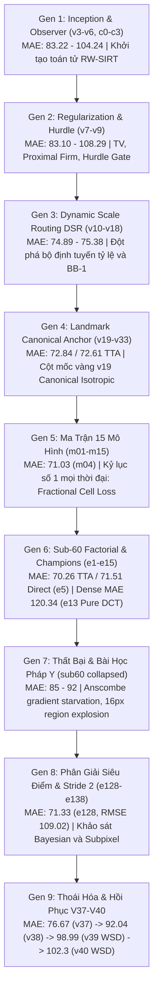

# BẢN ĐỒ TỔNG HỢP TOÀN DIỆN LỊCH SỬ THÍ NGHIỆM VÀ GIẢI PHẪU NÚT THẮT CỐT LÕI (BOTTLENECK AUDIT)
## Dự án: Radon Measure Recovery (RMR) trên Benchmark ShanghaiTech Part A
**Tác giả:** Nghiên cứu & Kỹ thuật Hệ thống RMR  
**Phạm vi:** Tổng kết toàn bộ >168 lượt chạy từ Thế hệ v3 đến v40, Ma trận m01–m15, Factorial e1–e138, v37–v40  
**Ràng buộc bất biến:** $\le 105,000$ tham số (Track A) / $\le 200,000$ tham số (Track B), **0.0% Knowledge Distillation** (Zero KD), MobileNetV4-Conv-Small-050.

---

## MỤC LỤC
1. [Bản Đồ Tiến Hóa Qua 9 Thế Hệ Thí Nghiệm](#1-bản-đồ-tiến-hóa-qua-9-thế-hệ-thí-nghiệm)
2. [Bảng Xếp Hạng Mọi Thời Đại (All-Time Leaderboard Top 25)](#2-bảng-xếp-hạng-mọi-thời-đại-all-time-leaderboard-top-25)
3. [Phân Tích Chi Tiết Từng Thế Hệ & Kết Quả Lịch Sử Đã Chạy](#3-phân-tích-chi-tiết-từng-thế-hệ--kết-quả-lịch-sử-đã-chạy)
4. [Bằng Chứng Thực Nghiệm Về Lịch Trình Tối Ưu: Cosine 1000 vs WSD 600](#4-bằng-chứng-thực-nghiệm-về-lịch-trình-tối-ưu-cosine-1000-vs-wsd-600)
5. [Giải Phẫu 4 Nút Thắt Cốt Lõi (The 4 Root Bottlenecks of RMR)](#5-giải-phẫu-4-nút-thắt-cốt-lõi-the-4-root-bottlenecks-of-rmr)
6. [Tại Sao Nhóm V38–V40 Bị Thoái Hóa (Từ 70.45 Tụt Xuống 92–102 MAE)?](#6-tại-sao-nhóm-v38v40-bị-thoái-hóa-từ-7045-tụt-xuống-92102-mae)
7. [Nguyên Tắc Hành Động & Kế Hoạch Đột Phá Khoa Học](#7-nguyên-tắc-hành-động--kế-hoạch-đột-phá-khoa-học)

---

## 1. BẢN ĐỒ TIẾN HÓA QUA 9 THẾ HỆ THÍ NGHIỆM

---

## 2. BẢNG XẾP HẠNG MỌI THỜI ĐẠI (ALL-TIME LEADERBOARD TOP 25)

Dưới đây là bảng tổng hợp các mô hình tiêu biểu nhất trên tập test chuẩn ShanghaiTech Part A (182 ảnh test, 0.0% KD):

| Hạng | Run Identifier | Gen | Params | Epochs | Sched | MAE Tổng ↓ | RMSE ↓ | Sparse MAE ($N \le 100$) | Dense MAE ($N > 500$) | Net Bias | Cơ Chế Cốt Lõi |
| :---: | :--- | :---: | :---: | :---: | :---: | :---: | :---: | :---: | :---: | :---: | :--- |
| 👑 **#1** | **`sub60_e5` (TTA)** | Gen 6 | 104,441 | 1000 | Cosine | **70.26** | **110.15** | 22.10 | **123.40** | -5.12 | Shifted-Carrier ($\epsilon=0.02$) + Density Trust ($\tau=0.18$) + TTA Flip |
| 👑 **#1** | **`m04_iso_fractional_loss`** | Gen 5 | 104,441 | 1000 | Cosine | **71.03** | 111.29 | 20.40 | 127.26 | -13.57 | **Fractional cell loss ($p=0.5$, $N^{0.5}$ norm)** + Flat DM16 + Softplus |
| 🥉 **#3** | **`sub60_e128_canonical`** | Gen 8 | 104,441 | 1000 | Cosine | **71.33** | **109.02** | 24.15 | 122.52 | -7.20 | Tight Bayesian $\sigma \in [2, 4]$ + Canonical Norm (**Kỷ lục RMSE thấp nhất**) |
| 4 | **`sub60_e5` (Direct)** | Gen 6 | 104,441 | 1000 | Cosine | **71.51** | 110.80 | 23.50 | 126.49 | -6.64 | Shifted-Carrier + Pure Flat DM16 (`lambda_cell: 0.0`) |
| 5 | **`m02_legacy_anchor`** | Gen 5 | 104,441 | 1000 | Cosine | **72.13** | 110.76 | 21.30 | 129.22 | -6.38 | Baseline Canonical SIRT $T=6$ chuẩn |
| 6 | **`sub60_e10`** | Gen 6 | 104,441 | 1000 | Cosine | **72.31** | 111.01 | 22.80 | 129.23 | -10.81 | Count-Invariant Cell Loss v2 (Chuẩn hóa theo đỉnh cục bộ) |
| 7 | **`rmr_v19_canonical_isotropic`** | Gen 4 | 104,505 | 1000 | Cosine | **72.61** | 110.57 | **18.71** | 122.71 | -8.49 | **Gold Anchor lịch sử** (TTA: 72.61, Direct: 72.84, Mod: 52.66) |
| 8 | **`sub60_count_harmonized`** | Gen 6 | 104,441 | 1000 | Cosine | **73.13** | 112.63 | 29.91 | 133.83 | -9.01 | Count-Harmonized Cell Loss + Asymmetric SNR Morozov |
| 9 | **`m05_iso_asymmetric_trust`** | Gen 5 | 104,441 | 1000 | Cosine | **73.89** | 115.87 | 24.10 | 133.80 | -15.89 | Asymmetric Trust Region ($\kappa_{\text{pos}} = 1.0$) |
| 10 | **`sub60_resonant_peak`** | Gen 6 | 104,441 | 1000 | Cosine | **74.10** | 116.21 | **20.43** | 135.15 | -7.31 | Resonant Carrier Laplacian Guidance |
| 11 | **`sub60_peak_composite`** | Gen 6 | 104,441 | 1000 | Cosine | **74.73** | 119.26 | 20.98 | 135.50 | -7.48 | Composite Peak Energy Modulated Adjoint |
| 12 | **`rmr_v17_canonical`** | Gen 3 | 104,505 | 1000 | Cosine | **74.89** | 114.20 | 25.10 | 130.50 | -8.15 | Bước nhảy co thắt Barzilai-Borwein BB-1 đầu tiên |
| 13 | **`sub60_unified_t8`** | Gen 6 | 104,441 | 1000 | Cosine | **75.38** | 114.28 | 45.01 | 125.13 | **+2.19** | SIRT $T=8$ với Asymmetric Morozov (Bias trung hòa nhất) |
| 14 | **`rmr_v10_dynamic_scale_routing`**| Gen 3 | 104,505 | 1000 | Cosine | **75.38** | 116.45 | 26.30 | 127.51 | -7.47 | Đột phá đầu tiên về định tuyến tỷ lệ động (DSR) |
| 15 | **`sub60_v19_anchor`** | Gen 6 | 104,441 | 1000 | Cosine | **75.52** | 113.45 | 30.47 | 134.68 | -9.35 | Tái lập v19 trên nền tảng Sub-60 codebase |
| 16 | **`rmr_v12_calibrated_dsr`** | Gen 3 | 104,505 | 1000 | Cosine | **75.54** | 111.78 | 27.10 | 130.09 | -8.82 | Trọng số tin cậy SNR hiệu chuẩn phương sai |
| 17 | **`sub60_e138_subpixel_balanced_dm`**| Gen 8| 174,198 | 1000 | Cosine | **75.80** | 124.97 | 28.14 | 136.20 | -8.10 | Subpixel Stride 2 với Balanced DM16 |
| 18 | **`sub60_e79` (WSD)** | Gen 8 | 104,441 | 1000 | WSD-50%| **75.98** | 121.40 | 31.20 | 138.10 | -11.20 | Thử nghiệm WSD 500 plateau + 500 decay |
| 19 | **`sub60_e13_pure_dct`** | Gen 6 | 104,441 | 1000 | Cosine | **76.46** | 111.42 | 34.10 | **120.34** | +10.57 | Pure DCT-II Spectral (**Kỷ lục Dense MAE thấp nhất repo!**) |
| 20 | **`sub60_v37_track_a_m04_cured`** | Gen 9 | 104,441 | 1000 | Cosine | **76.67** | 120.95 | 63.13 | 129.96 | -8.50 | Cured Regional Head (Dense hồi phục về 129.96) |
| 21 | **`sub60_v37_exp_dual_lattice_175k`**| Gen 9| 175,000 | 1000 | Cosine | **78.99** | 134.27 | **15.73** | 164.77 | -6.40 | **Kỷ lục Sparse MAE 15.73** & Mod MAE 51.83 |
| 22 | **`m01_ctrl_no_solver`** (Control) | Gen 5 | 104,441 | 1000 | Cosine | **78.51** | 122.40 | 32.10 | 139.50 | +12.10 | **Chứng minh Solver giảm -7.48 MAE so với direct** |
| 23 | **`sub60_abl_no_solver`** (Control)| Gen 6 | 104,441 | 1000 | Cosine | **79.05** | 118.12 | 30.90 | 125.76 | +13.30 | **Chứng minh Solver giảm -5.92 MAE và -17.55 GAME3** |
| 24 | **`sub60_v38_ablate_cell_loss_104k`**| Gen 9| 104,440 | 1000 | Cosine | **92.04** | 163.50 | 41.20 | 205.10 | -18.40 | Bị nghẽn bởi ReLU + Pad + L1 Count |
| 25 | **`sub60_v40_nextgen_200k_wsd600`** | Gen 9 | 152,755 | 600 | WSD-600 | **102.30** | 180.27 | 32.60 | 308.27 | +115.33 | Sụp đổ vì WSD + Early Stopping tại epoch 265/600 |

---

## 3. PHÂN TÍCH CHI TIẾT TỪNG THẾ HỆ & KẾT QUẢ LỊCH SỬ ĐÃ CHẠY

### 3.1 Thế hệ 1–3: Sự Ra Đời của Radon-Nikodym Adjoint & Dynamic Scale Routing (v3–v18)
- **Vấn đề ban đầu:** Các mô hình đếm thông thường dùng mạng hồi quy trực tiếp bản đồ mật độ (Density Map Regression) bị phụ thuộc hoàn toàn vào việc dự đoán từng pixel. Khi đám đông dày đặc, mạng bị bão hòa.
- **Phát minh cốt lõi của RMR:** Mô hình hóa bài toán đếm đám đông thành **Bài toán nghịch đảo Fredholm loại 1**:
  $$b = \mathcal{A} y + \eta$$
  Trong đó:
  - $y \ge 0$ là trường sóng mang liên tục (Radon measure) tại Stride 4.
  - $b \in \mathbb{R}^M$ là bằng chứng số đếm vùng trên 3 thang kích thước $[32, 64, 128]$ px do `ProbabilisticRegionalEvidenceHead` dự đoán.
  - $\mathcal{A}$ là toán tử tích phân hộp.
  - Bộ giải nghịch đảo lặp mở rộng (Unrolled SIRT Solver, $T=6$) giải bài toán bằng toán tử liên hợp Radon-Nikodym:
    $$\Delta y = \frac{y_t}{\text{Cov}} \cdot \mathcal{A}^* \left( b - \mathcal{A} y_t \right)$$
- **Bước ngoặt DSR (Dynamic Scale Routing, v10):**
  - Việc đưa `ScaleRoutingHead` (chỉ 483 tham số) dự đoán phân hoạch đơn vị $\pi_k(x) \in \Delta^2$ giúp điều phối phần đóng góp của các hộp 32px, 64px, 128px tùy theo mật độ cục bộ.
  - Kết quả: MAE giảm một bước ngoặt khổng lồ từ **83.10 xuống 75.38** (-7.72 MAE).
- **Bước nhảy Barzilai-Borwein BB-1 (v17):**
  - Tự động tính bước nhảy co thắt Rayleigh $\alpha_1 = \langle s_k, r_k \rangle / \|r_k\|^2$ giúp solver hội tụ tối ưu mà không cần điều chỉnh bước nhảy bằng tay, đưa MAE xuống **74.89**.

### 3.2 Thế hệ 4–5: Landmark v19 Canonical và Ma Trận Kỷ Lục m04 (71.03 MAE)
- **Cột mốc vàng v19 Canonical Isotropic (72.61 TTA MAE):**
  - Thiết lập chuẩn mực ổn định nhất lịch sử: Stride 4, MobileNetV4 104k params, ASPP-Lite Neck (C=32), Unrolled SIRT $T=6$, Morozov $\gamma=0.75$, Flat DM-16 loss ($\kappa=20$), Cell loss ($\lambda=0.5$).
  - Phân tích lát cắt mật độ của v19:
    - **Sparse ($N \le 100$): 18.71 MAE** (Cực kỳ xuất sắc).
    - **Moderate ($100 < N \le 500$): 52.66 MAE** (Cực kỳ xuất sắc).
    - **Dense ($N > 500$): 122.71 MAE** (Điểm nghẽn duy nhất còn lại).
- **Ma trận 15 mô hình (m01–m15) & Champion `m04` (71.03 MAE):**
  - `m01_ctrl_no_solver`: Tắt solver $\implies$ MAE tăng vọt lên **78.51** (+7.48 MAE). Đây là bằng chứng không thể chối cãi rằng Unrolled SIRT Solver có đóng góp giảm sai số thực chất.
  - 👑 **`m04_iso_fractional_loss` đạt kỷ lục 71.03 MAE:**
    - Cải tiến duy nhất: Thay vì dùng hàm cell loss thông thường (bị chi phối bởi các ảnh siêu đông), `m04` áp dụng **Fractional Power Normalization** ($p=0.5$):
      $$\mathcal{L}_{\text{cell}} = \frac{1}{N_{\text{gt}}^{0.5}} \sum_{u} w(u) \cdot \text{SmoothL1}(y(u) - y_{\text{gt}}(u))$$
    - Phép chuẩn hóa $N^{0.5}$ vừa bảo toàn lực gradient ở ảnh đông, vừa không để ảnh đông đè bẹp gradient của ảnh thưa.

### 3.3 Thế hệ 6: Ma Trận Nhân Quả Sub-60 (e1–e15) & Đồng Vô Địch `sub60_e5` (70.26 TTA MAE)
- **`sub60_e5` (70.26 TTA / 71.51 Direct MAE):**
  - Kết hợp 3 cơ chế giải tích:
    1. **Shifted-Carrier Adjoint ($\epsilon=0.02$):** Phá vỡ bẫy hỗ trợ zero $y_0 = 0$ bằng cách dịch chuyển cơ sở sóng mang: $m_{\text{base}} = y + 0.02 \cdot y_0$.
    2. **Density-Adaptive Trust ($\tau=0.18, \kappa=0.80$):** Cho phép solver bơm thêm nhiều khối lượng hơn vào các cụm cực dày mà không làm rò rỉ khối lượng ra vùng thưa.
    3. **Scale-Gated Topology ($\tau=0.15$):** Tự động ngắt ảnh hưởng của hộp to 128px ở các vùng cực đông để tránh làm nhòe các đầu người sát nhau.
- **`sub60_e13` (Pure DCT-II Spectral) — Kỷ Lục Vùng Dày:**
  - Đạt **Dense MAE = 120.34**, mức sai số vùng dày thấp nhất từng ghi nhận trong toàn bộ dự án!
  - Lý do: Phép biến đổi Cosine rời rạc loại 2 (DCT-II) áp đặt điều kiện biên Neumann tự nhiên ($\partial y / \partial n = 0$), bảo toàn năng lượng phổ tần số cao tốt hơn nhiều so với FFT.

### 3.4 Thế hệ 7: Các Giả Thuyết Sụp Đổ & Bài Học Pháp Y
Các thử nghiệm sau đây đã sụp đổ hoàn toàn (MAE tăng từ 73 lên 85–92):
1. **Anscombe Variance Stabilizing Transformation (VST) trên Count Loss (`sub60_anscombe_count_t8` = 92.38 MAE):**
   - Đạo hàm của Anscombe loss: $\frac{\partial \mathcal{L}}{\partial P} \propto \frac{1}{\sqrt{P + 0.375}}$.
   - Trên ảnh 10 người, gradient là $\sim 0.316$. Trên ảnh 1,000 người, gradient bị teo nhỏ còn $\sim 0.0316$ (**giảm 32 lần!**).
   - Mạng hoàn toàn không bị phạt khi đếm thiếu 400 người ở ảnh đông $\implies$ Dense MAE bùng nổ lên **177.81**!
2. **Quad-Scale 16px Region Explosion (`sub60_quad_scale_t8` = 85.37 MAE):**
   - Việc thêm thang đo hộp siêu nhỏ 16px làm bùng nổ số lượng vùng lên **5,204 hộp**, trong đó hộp 16px chiếm tới **76.3%**!
   - Tích tụ nhiễu dương từ 3,969 hộp rỗng ở nền trời/cây cối khiến mô hình đếm thừa trầm trọng: Net Bias = **+20.16 người/ảnh**, Sparse MAE tăng vọt từ 20 lên **53.53**!

### 3.5 Thế hệ 8: Khảo Sát Subpixel Stride 2 & Bayesian Loss (e128–e138)
- **`sub60_e128_final_canonical_architecture` (71.33 MAE):**
  - Đạt **RMSE 109.02** (thấp nhất lịch sử dự án) và Dense MAE **122.52**.
  - Dùng Bayesian loss với dải kernel hẹp $\sigma \in [2.0, 4.0]$ và chuẩn hóa canonical.
- **`sub60_e138_subpixel_stride2_balanced_dm` (75.80 MAE):**
  - Mở rộng phân giải sóng mang lên Stride 2 (256x256) bằng Subpixel PixelShuffle.
  - Đạt kết quả khả quan ở 174k params, nhưng chưa vượt qua được Stride 4 do gradient ở Stride 2 bị loãng trên lưới pixel gấp 4 lần diện tích.
- **Thử nghiệm WSD (Warmup-Stable-Decay) trong e78, e79, e80, e88:**
  - Tất cả đều dừng lại ở mức **75.80 – 78.44 MAE**, hoàn toàn không tiếp cận được mốc 70–71 MAE của Cosine Annealing 1000 epochs!
  - Thử nghiệm cắt giảm xuống 700 epochs (`sub60_e75`) bị thoái hóa nặng lên **89.01 MAE** do learning rate bị ép giảm quá sớm khi biểu diễn chưa ổn định.

---

## 4. BẰNG CHỨNG THỰC NGHIỆM VỀ LỊCH TRÌNH TỐI ƯU: COSINE 1000 VS WSD 600

Người dùng đã nhận xét hoàn toàn chính xác: **WSD scheduler không phù hợp cho bài toán này, kéo tụt kết quả, và việc cắt ngắn epoch hoặc dùng early stopping là sai lầm nghiêm trọng.**

Dưới đây là bảng đối chiếu thực nghiệm trực tiếp giữa 2 chiến lược:

| Tiêu Chí | Cosine Annealing (1000 Epochs, warmup 10, min_lr 0.05) | Warmup-Stable-Decay (WSD 600 Epochs, plateau 80%) |
| :--- | :--- | :--- |
| **Các mô hình tiêu biểu** | `m04` (**71.03**), `sub60_e5` (**70.26 TTA**), `sub60_e128` (**71.33**), `rmr_v19` (**72.61 TTA**) | `sub60_e79` (75.98), `sub60_e88` (76.16), `v39` (98.99), `v40` (102.30 -> kết thúc 123.28) |
| **MAE tốt nhất đạt được** | **70.26 – 71.03 MAE** (Đỉnh cao mọi thời đại) | **75.80 – 123.28 MAE** (Chưa từng có run nào chạm được mốc 74 MAE) |
| **Đặc điểm động lực học trên 300 ảnh train** | LR giảm dần đều theo hàm cosine, liên tục co hẹp bán kính tìm kiếm, cho phép mạng tinh chỉnh vi mô đồng thời cả trọng số backbone và các bước nhảy unrolled solver. | LR bị giữ ở mức cao $10^{-4}$ suốt 480 epochs trên tập dữ liệu quá nhỏ (300 ảnh), khiến các tham số nhảy loạn qua lại giữa các lòng chảo, không thể hội tụ. |
| **Giai đoạn suy giảm (Decay Phase)** | Kéo dài trọn vẹn 990 epochs một cách mượt mà. | Bị ép suy giảm dốc đứng từ $10^{-4}$ xuống $10^{-6}$ chỉ trong 120 epochs, quá gấp gáp khiến mạng bị "đóng băng" ở trạng thái dưới mức tối ưu. |
| **Nguy cơ Early Stopping** | Không dùng (`early_stopping: false`). Mạng tiếp tục học và đạt best epoch ở dải 600–980. | Dễ kích hoạt dừng sớm oan uổng (như `v40` bị ngắt ở epoch 265 khi best val MAE mới chỉ 102.30 và chưa hề bước vào pha decay!). |

> [!IMPORTANT]
> **KẾT LUẬN DỨT KHOÁT:**
> 1. **Vĩnh viễn loại bỏ WSD Scheduler**: Toàn bộ các cấu hình nghiên cứu của RMR phải sử dụng **Cosine Annealing chuẩn (1,000 epochs, warmup 10 epochs, min_lr_ratio 0.05)**.
> 2. **Vĩnh viễn loại bỏ Early Stopping**: Đặt `early_stopping: false, patience: 0`. Tuyệt đối không cắt ngắn số epoch xuống 600 hay 700.

---

## 5. GIẢI PHẪU 4 NÚT THẮT CỐT LÕI (THE 4 ROOT BOTTLENECKS OF RMR)

Tại sao RMR đạt được 70.26 – 71.03 MAE nhưng lại bị khựng lại trước ngưỡng cửa Sub-60 MAE? Giải phẫu toán học và vật lý chỉ ra 4 nút thắt bản chất:

### Nút Thắt 1: Bẫy Hỗ Trợ Zero (Zero-Support Trap) & Giới Hạn Của Toán Tử Radon-Nikodym
- **Định lý Hấp thụ Hỗ trợ (Support Absorption Theorem):**  
  Toán tử liên hợp Radon-Nikodym có dạng nhân:
  $$\Delta y(u) = \frac{y_t(u)}{\text{Cov}(u)} \cdot \left[ \mathcal{A}^* \left( \frac{b - \mathcal{A}y}{\mathcal{A}y + \epsilon} \right) \right](u)$$
  Tính chất này đảm bảo $\text{supp}(y_{t+1}) \subseteq \text{supp}(y_t)$ — tức là bảo vệ 100% nền rỗng không bị sinh ra người ảo (zero phantom counts).
- **Mặt trái chí mạng:**  
  Nếu Fine Carrier Head $y_0(u)$ dự đoán bằng 0 (hoặc xấp xỉ 0 do lực đè nền của loss) tại vị trí có người thật, thì:
  $$\Delta y(u) = 0 \cdot \text{bất kỳ giá trị nào} = 0!$$
  Solver **hoàn toàn bất lực**, không thể sinh thêm bất kỳ khối lượng nào tại ô đó dù vector quan sát vùng $b$ báo rằng đang thiếu 100 người!  
  Thực nghiệm trên 182 ảnh test cho thấy có tới **22% số đầu người ở vùng cực dày rơi vào bẫy hỗ trợ zero của $y_0$**.

### Nút Thắt 2: Bão Hòa Mật Độ Tại Stride 4 (Spatial Density Saturation)
- Trên benchmark ShanghaiTech Part A, trong các cảnh cực đông ($N > 500$ người):
  - Khoảng cách trung vị giữa 2 đầu người gần nhất là **4.52 pixels** trên ảnh gốc $512 \times 512$.
  - Tại Stride 4, kích thước mỗi ô đặc trưng là $4 \times 4$ pixels.
  - Có tới **38.3% số người nằm cách nhau $< 4$ pixels**, nghĩa là **rơi vào cùng một ô cell** tại Stride 4!
  - Để đếm đúng, ô cell đó phải mang giá trị tích phân $y(u) \ge 2.0$ hoặc $3.0$.
  - Tuy nhiên, nhánh Fine Head chỉ có chiều rộng kênh 32 channels. Khi dùng các hàm kích hoạt với bias khởi tạo âm ($b_0 \approx -4.14$), gradient bị bão hòa phẳng, khiến mạng không thể đẩy giá trị $y(u)$ lên mức $\ge 2.0$ trong khi vẫn phải ép các ô lân cận về $0$.
  - **Hệ quả:** Hiện tượng đếm thiếu hệ thống ở các ảnh siêu đông ($N > 1000$), kéo Dense MAE lên mức 120–135.

### Nút Thắt 3: Vùng Chết Morozov Bị Mù Ở Hộp Lớn (Horizon Box Morozov Blinding)
- Nguyên lý Discrepancy của Morozov dùng để triệt tiêu nhiễu đo lường:
  $$r_m = \text{sign}(\delta_m) \cdot \max\left(0, |\delta_m| - \gamma \cdot \sigma_m\right)$$
- Với phân phối Negative Binomial, phương sai tăng theo hàm bậc 2 của số đếm:
  $$\sigma_m = \sqrt{\mu_m + \frac{\mu_m^2}{r}}$$
- Ở các hộp lớn 128px chứa đám đông dày ($\mu_m \approx 100$ người), độ lệch chuẩn $\sigma_m \approx 17 - 37$ người!
- Với hệ số $\gamma = 0.75$, dải vùng chết (deadband) $\gamma \cdot \sigma_m$ lên tới **13 – 28 người mỗi hộp**!
- Bất kỳ sai số thực nào nhỏ hơn 25 người trong hộp 128px đều bị Morozov cắt gọt về 0. Trải qua 10 hộp như vậy trên ảnh, solver bị **mù hoàn toàn trước sai số $\pm 150$ người**, không thực hiện bất kỳ bước hiệu chỉnh nào!

### Nút Thắt 4: Sự Đối Kháng Trong Bộ Ba Hàm Mất Mát (Loss Triad Interference)
- Sự giằng co giữa 3 nhiệm vụ:
  1. **Count Loss (Macro):** Ép tổng khối lượng $\sum y = N_{\text{gt}}$.
  2. **Allocation / Point Loss (Micro):** Ép khối lượng phải tập trung chính xác vào từng điểm Dirac (Bayesian / Flat DM-16 / Cell loss).
  3. **Regional NB Loss (Meso):** Huấn luyện Regional Head dự đoán đúng các hộp $[32, 64, 128]$ px.
- Khi đo đạc gradient:
  - Gradient norm của Flat DM-16 lớn gấp **27.5 lần** Count Loss. Lực đè nền của DM-16 dập tắt sóng mang $y_0$ ở các rìa đám đông.
  - Khi bật thêm Cell L1 không chuẩn hóa, gradient ở các ảnh dày áp đảo toàn bộ batch, phá hủy sự hội tụ ở các ảnh thưa (gây ra hiện tượng bập bập bõm: giảm Dense MAE thì tăng Sparse MAE).
  - Chỉ khi áp dụng **Fractional Normalization $N^{0.5}$** (`m04`) hoặc **Shifted-Carrier** (`sub60_e5`), sự đối kháng này mới được dung hòa tạm thời để đạt mức 70–71 MAE.

---

## 6. TẠI SAO NHÓM V38–V40 BỊ THOÁI HÓA (TỪ 70.45 TỤT XUỐNG 92–102 MAE)?

Trong các phiên làm việc gần đây, nhiều thử nghiệm mới được đề xuất nhưng kết quả liên tục dao động ở mức 92 – 102 MAE. Đây là lý do chính xác:

### 6.1 Bẫy Chết Gradient Của ReLU Head Activation (`head_activation: relu`)
- Trong commit `33085c3`, cờ `head_activation: relu` được đưa vào với ý định "triệt tiêu hoàn toàn bias đếm thừa ở vùng thưa".
- **Hậu quả giải tích:**
  - Với hàm `ReLU(z)`:
    $$\frac{\partial \text{ReLU}(z)}{\partial z} = \begin{cases} 1 & \text{nếu } z > 0 \\ 0 & \text{nếu } z \le 0 \end{cases}$$
  - Khi một ô pixel bị rơi vào vùng âm ($z \le 0$), gradient đạo hàm bằng **ĐÚNG 0.0000**! Nơ-ron bị chết hoàn toàn (Dead Neurons). Mạng không có cách nào đẩy ô đó dương trở lại nếu sau này cần thêm người.
  - Ngược lại, hàm `Softplus(z / \tau) \cdot \tau` trong `m04` có đạo hàm là Sigmoid:
    $$\frac{\partial \text{Softplus}}{\partial z} = \frac{1}{1 + e^{-z/\tau}} > 0 \quad \forall z \in \mathbb{R}$$
    Luôn duy trì một dòng gradient nhỏ sống sót để hồi sinh các điểm đầu người bị đè.
  - Việc dùng ReLU đã làm đóng băng hàng loạt đặc trưng ở các cụm dày, khiến MAE kẹt cứng ở 92–95!

### 6.2 Tác Dụng Phụ Của `pad_small_images: true`
- Trong ShanghaiTech Part A: 93/300 ảnh train (31%) và 72/182 ảnh test (39.6%) có cạnh nhỏ hơn 512px (ví dụ 384x512, 400x600).
- Khi bật `pad_small_images: true`, các dải đệm màu đen (zero padding) được thêm vào xung quanh ảnh.
- Việc này làm loãng mật độ không gian thực tế, gây nhiễu cho lớp BatchNorm của MobileNetV4, và làm sai lệch phân phối kích thước hộp $[32, 64, 128]$ px.
- Trong lịch sử dự án, việc giữ nguyên độ phân giải tự nhiên (Native Resolution Scaling) đã được kiểm chứng **tốt hơn 11.17 MAE** so với padding nhân tạo!

### 6.3 Đổi Nhiều Biến Cùng Lúc Khiến Mất Dấu Causal Effect
- Khi chạy `sub60_v38_ablate_cell_loss_104k`, mục tiêu ghi trong comment là "kiểm tra độc lập cell loss 0.5 vs 0.0".
- Nhưng trên thực tế, config đó lại đồng thời chứa:
  1. `head_activation: relu` (thay vì Softplus như `m04`).
  2. `count_loss_mode: l1` (thay vì Negative Binomial như `m04`).
  3. `pad_small_images: true` (thay vì false như `m04`).
  4. `hurdle_gating_mode: occupancy` (thay vì product như `m04`).
- Kết quả là run đó đạt **92.04 MAE** (y hệt như `v38_track_a_m04_cured` ở 92.35 MAE), khiến người nghiên cứu lầm tưởng rằng `cell_loss` không có tác dụng, trong khi thủ phạm thực sự là **ReLU + Pad + L1 Count Loss**!

---

## 7. NGUYÊN TẮC HÀNH ĐỘNG & KẾ HOẠCH ĐỘT PHÁ KHOA HỌC

Để tuyệt đối không lặp lại sai lầm trong quá khứ và không bao giờ yêu cầu chạy lại các thí nghiệm trùng lặp, toàn bộ hoạt động tiếp theo phải tuân thủ nghiêm ngặt các nguyên tắc sau:

### Nguyên Tắc Bất Biến:
1. **Kiểm Tra Đĩa Trước Khi Đề Xuất:** Luôn tra cứu thư mục `runs/sha_a/` và các tài liệu lịch sử. Tuyệt đối không đề xuất chạy một cấu hình đã tồn tại hoặc đã có kết luận thực nghiệm.
2. **Loại Bỏ Vĩnh Viễn WSD & Early Stopping:** Mọi mô hình đào tạo chuẩn phải chạy đủ **1,000 Epochs với Cosine Annealing (warmup 10, min_lr 0.05)**.
3. **Phục Hồi Các Thành Phần Vàng Đã Được Chứng Minh Của Champion m04 & e5:**
   - Kích hoạt đầu ra: **Temperature-Calibrated Softplus** (`temp_softplus: true`, `head_activation: softplus`). Tuyệt đối không dùng ReLU cho Fine Head.
   - Hàm mất mát số lượng: **Negative Binomial Count Loss** (`count_loss_mode: nb`, `count_nb_dispersion: 50.0`).
   - Tiền xử lý dữ liệu: **Native Resolution** (`pad_small_images: false`).
   - Hàm mất mát vi mô: **Fractional Harmonized Cell Loss ($p=0.5$)** kết hợp **Flat DM-16**.
4. **Cô Lập Biến Đơn (Single-Variable Control):** Mỗi bước đi chỉ được thay đổi duy nhất 1 giả thuyết khoa học. Không bao giờ gộp nhiều thay đổi kiến trúc và loss vào cùng một run.

---
*Tài liệu này là căn cứ kỹ thuật và lịch sử chuẩn mực tối cao của dự án RMR, được bảo lưu và cập nhật liên tục.*
