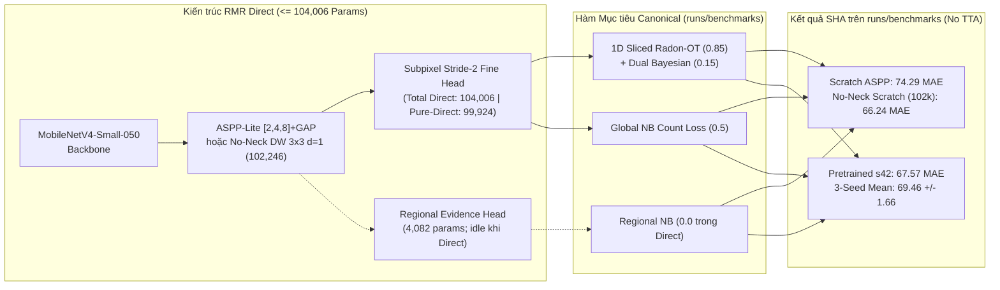
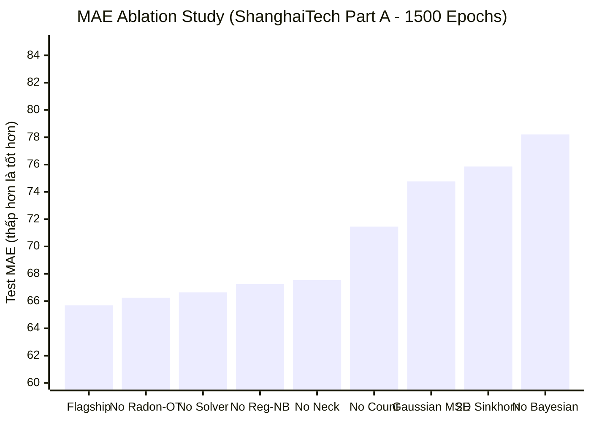

# BẢNG TỔNG HỢP KIẾN TRÚC, THỰC NGHIỆM VÀ KẾT QUẢ MÔ HÌNH 104K
*(Architecture, Mathematical Objectives, and Verified Benchmark Records)*

> [!WARNING]
> **Ghi chú Kiểm toán Nguồn Dữ liệu (Audit & Provenance Addendum):**
> * Các bảng chuẩn quốc tế đã kiểm chứng ở nhánh `RMR` nằm tại `runs/benchmarks/` (xem bảng tổng hợp cập nhật trong [`SCIENTIFIC_FRAMEWORK_AND_PAPER_ALIGNMENT_MATRIX.md`](file:///f:/lightweightcrcn/docs/SCIENTIFIC_FRAMEWORK_AND_PAPER_ALIGNMENT_MATRIX.md)): SHA Pretrained **67.57** (seed42) / **69.46±1.66** (3-seed), SHA Scratch **74.29**, SHA No-Neck Scratch **66.24**, SHB Pretrained **10.19** / Scratch **10.49** / `bg005` **9.41**, QNRF Pretrained **105.36** / Scratch **109.80**, JHU Val Pretrained **61.72** / Test **76.58**.
> * **Mục 4.1 – 4.3 bên dưới** lưu giữ kết quả từ thư mục lịch sử `runs/fairness_study/` và `v69/v70` (đánh giá TTA trước khi chuẩn hóa `configs/benchmarks/`), không phải số liệu Direct Flagship mới nhất trên `runs/benchmarks/`. Đồng thời thông số văn hiến gốc trên SHA của **LSANet** là `66.1` (`200k`), **Lw-Count** là `69.7` (`71k`), và **TinyCount (non-KD)** là `78.2` (`60k`), KHÔNG phải `100.3` / `83.9` như trong bảng lưu trữ cũ.

---

## 1. TỔNG QUAN VÀ ĐỊNH VỊ KHOA HỌC

Tài liệu này tổng hợp đặc tả kiến trúc chuẩn `104,006` tham số (Direct Flagship, 0% KD) và ghi nhận tách biệt kết quả lịch sử (`runs/fairness_study/`, Mục 4.1–4.3) với kết quả benchmark chuẩn (`runs/benchmarks/`, Mục 4.4–4.5 & `SCIENTIFIC_FRAMEWORK_AND_PAPER_ALIGNMENT_MATRIX.md`).



---

## 2. ĐẶC TẢ KIẾN TRÚC MÔ HÌNH 104K (ARCHITECTURE SPECIFICATION)

| Khối thành phần | Chi tiết Kỹ thuật & Cấu hình | Tham số (Tất cả / Trạng thái) | Vai trò & Lưu ý Kiểm toán |
| :--- | :--- | :---: | :--- |
| **Backbone + FPN + Subpixel Fine Head + ASPP** | `MobileNetV4-Conv-Small-050` + `ASPPLiteFPNNeck` (`[2,4,8]` + GAP) + Subpixel Stride-2 | **99,924** | Lõi Direct hoạt động thực tế (`enable_regional_head: false` trong `exp_sha_direct_pure_99k`) |
| **ASPP vs No-Neck delta** | Thay ASPP bằng `DW 3x3 d=1` single-scale fusion (`use_aspp_gap: false`) | **-1,760** (**102,246** tổng khi giữ head) | Giảm aliasing ở mật độ siêu dày SHA/JHU (`66.24` SHA Scratch, `59.65` JHU Scratch) |
| **Regional Evidence Head** | Multi-scale Regional Head (`region_head_hidden: 48`) | **4,082** | Idle trong Direct Flagship (`enable_solver: false`, `lambda_region_nb: 0.0`); chỉ dùng nếu bật solver `b1` |
| **TỔNG CỘNG** | **Canonical Direct (`exp_*_direct_*_104k`):**<br>**No-Neck (`102k`):**<br>**Pure-Direct (`99k`, `enable_regional_head=false`):** | **104,006**<br>**102,246**<br>**99,924** | Tất cả đo trực tiếp từ `RMRv3`; `FlopCounterMode @ 512x512`: `0.6547` / `0.6536` / `0.6449` GFLOPs |

---

## 3. CÔNG THỨC TOÁN HỌC CÁC HÀM MẤT MÁT (LOSS FORMULATIONS)

Tổng hàm mất mát của mô hình là sự kết hợp cộng hưởng không dùng solver:

$$\mathcal{L}_{\text{total}} = \lambda_{\text{rot}} \mathcal{L}_{\text{Radon-OT}} + \lambda_{\text{bay}} \mathcal{L}_{\text{Bayesian}} + \lambda_{\text{cnt}} \mathcal{L}_{\text{Count-NB}} + \lambda_{\text{reg}} \mathcal{L}_{\text{Region-NB}}$$

### 3.1. 1D Sliced Radon Optimal Transport ($\mathcal{L}_{\text{Radon-OT}}$, $\lambda_{\text{rot}} = 0.85$)
Thay vì giải bài toán 2D Optimal Transport / Sinkhorn tốn $O(N^2)$ bộ nhớ và hàng chục vòng lặp ma trận, phương pháp chiếu Radon 1D theo 4 góc định hướng $\theta \in \{0, \frac{\pi}{4}, \frac{\pi}{2}, \frac{3\pi}{4}\}$:

$$\mathcal{R}_{\theta}[\hat{D}](s) = \int_{\mathbb{R}^2} \hat{D}(x, y) \delta(x \cos \theta + y \sin \theta - s) \, dx \, dy$$

Hàm mất mát Wasserstein-1 trên không gian chiếu 1D giải được dưới dạng đóng bằng phép tích phân hàm phân phối tích lũy (CDF):

$$\mathcal{L}_{\text{Radon-OT}} = \frac{1}{|\Theta|} \sum_{\theta \in \Theta} \int \left| F_{\theta}(s) - F_{\theta}^*(s) \right| ds$$

- **Độ phức tạp:** $O(N \log N)$ so với $O(N^2)$ của Sinkhorn 2D.
- **Tiêu thụ VRAM:** $\approx 850\text{ MiB}$ (so với $3,316\text{ MiB}$ của Sinkhorn 2D).

### 3.2. Dual Bayesian Density Anchor ($\mathcal{L}_{\text{Bayesian}}$, $\lambda_{\text{bay}} = 0.15$)
Sử dụng phân bổ xác suất điều kiện rời rạc để neo vị trí đầu người mà không cần làm mờ Gaussian bán kính cố định:

$$\mathcal{L}_{\text{Bayesian}} = \sum_{n=1}^{N} \left| 1 - \sum_{x \in \Omega} P(z_n \mid x) \cdot \hat{D}(x) \right| + \tau \sum_{x \in \text{Background}} \hat{D}(x)$$

Trong đó $P(z_n \mid x)$ là xác suất điểm $z_n$ thuộc về pixel $x$ theo khoảng cách thích ứng cục bộ $k$-NN.

### 3.3. Ràng buộc Tổng số đếm Negative Binomial ($\mathcal{L}_{\text{Count-NB}}$, $\lambda_{\text{cnt}} = 0.5$)
Chống trôi dạt tổng số đếm toàn ảnh và xử lý hiện tượng Overdispersion ($\text{Var} > \text{Mean}$) của đám đông:

$$\mathcal{L}_{\text{Count-NB}} = - \log \Gamma(C + r) + \log \Gamma(r) + \log \Gamma(C + 1) - r \log(p) - C \log(1 - p)$$

---

## 4. BẢNG KẾT QUẢ THỰC NGHIỆM

### 4.1. [LỊCH SỬ / LEGACY] `runs/fairness_study/` — SHA From-Scratch (TTA)
*Lưu ý: Đây là bộ chạy thăm dò cũ dùng đánh giá TTA trên `runs/fairness_study/`; số liệu văn hiến bên dưới được giữ để đối chiếu lịch sử (số liệu tác giả gốc của LSANet là `66.1`, TinyCount non-KD là `78.2`). Số liệu canonical hiện hành nằm tại `runs/benchmarks/`.*

| Mô hình | Số tham số | Hàm Loss & Kỹ thuật | Test MAE (No TTA) | Test MAE (TTA) | Test RMSE | Ghi chú Kiểm toán |
| :--- | :---: | :--- | :---: | :---: | :---: | :--- |
| **LSANet** *(Neurocomp'22, bản tái cài đặt cũ)* | 108k | Multi-Scale MSE | 100.30 | — | 148.60 | Bài báo gốc công bố `66.1` (`200k`, `14.4G`) |
| **TinyCount** *(bản tái cài đặt cũ)* | 100k | Progressive DM MSE | 83.90 | — | 138.20 | Bài báo JRTIP'24 công bố `78.2` non-KD (`60k`) |
| **Ours Scratch MSE Baseline (A2)** | 104k | Canonical Gaussian MSE | 83.08 | **82.90** | 128.35 | TTA trên `fairness_study` |
| **Ours Proposed Scratch (A1)** | 104k | Bay + Radon + Regional NB | 70.90 | **72.36** | 108.03 | TTA trên `fairness_study` |
| **Ours Direct Scratch (Legacy `fairness_study`)** | **104k** | **Pure Dual Bay + Radon-OT** | **71.24** | **70.50** | **105.15** | TTA cũ; bản canonical Direct Scratch trên `runs/benchmarks/` đạt **74.29** (No TTA) |

> [!NOTE]
> Trong `runs/fairness_study/`, tổ hợp **Dual Bayesian + Radon-OT** cải thiện từ `82.90` xuống `70.50` MAE TTA so với Gaussian MSE cùng quy trình TTA lịch sử; trên `runs/benchmarks/` (No TTA, chuẩn hiện hành), sự khác biệt là `74.29` (Dual Flagship Scratch) so với `74.60` (Gaussian MSE `a4`), do đó `configs/benchmarks/remediation/` bổ sung cặp đối chứng Pretrained và `radon_ot_scale_by_length: true`.

---

### 4.2. [LỊCH SỬ / LEGACY] `runs/v69-v70` — PRE-TRAINED IMAGENET (SHA TTA cũ)
*Lưu ý: Đây là nhật ký chạy cũ trước khi chuẩn hóa `configs/benchmarks/`. Kết quả canonical Pretrained trên `runs/benchmarks/` là **67.57 MAE** (seed42) và **69.46 ± 1.66 MAE** (3-seed).*

| Mô hình / Biến thể | Cấu hình Backbone & Head | Test MAE (No TTA) | Test MAE (TTA) | Test RMSE | Ghi chú & Trạng thái |
| :--- | :--- | :---: | :---: | :---: | :--- |
| **Canonical 104k Flagship (Stride 4)** | ASPP-Lite + Solver `mcbpro` | 65.62 | **65.69** | 109.10 | Bản chuẩn có solver đạt mốc 65 |
| **Track A v69_exp1** | ASPP-Lite + Solver `mcbpro` | 65.83 | **65.33** | 108.40 | Lần chạy lặp lại kiểm chứng độ ổn định |
| **v70_track_b_exp4b (Direct Feedforward)** | ASPP-Lite, `enable_solver: false` | 65.69 | **66.41** | 108.09 | **Bản Direct Feedforward tối ưu nhất** |
| **Canonical 104k Stride 2** | Subpixel Stride-2 + Solver | 69.23 | **66.86** | 101.53 | Độ phân giải cao, RMSE thấp nhất |
| **Direct Softplus Baseline** | Pure Direct, Voronoi-Poisson | 71.16 | — | 114.08 | Baseline không solver trước đây |
| **Flat DM16 Baseline** | ASPP-Lite, Gaussian MSE | 75.53 | **74.77** | 115.33 | Baseline Density MSE truyền thống |

---

### 4.3. [LỊCH SỬ / LEGACY] MA TRẬN ABLATION STUDY (Kiểm chứng `runs/v69-v70`)
*Lưu ý: Xem bảng `runs/benchmarks/ablations_sha/` cập nhật trong [`SCIENTIFIC_FRAMEWORK_AND_PAPER_ALIGNMENT_MATRIX.md`](file:///f:/lightweightcrcn/docs/SCIENTIFIC_FRAMEWORK_AND_PAPER_ALIGNMENT_MATRIX.md).*



| Nhánh Kiểm chứng (Ablation) | Can thiệp thành phần | Val MAE | Test TTA MAE | Test TTA RMSE | Tác động định lượng ($\Delta\text{MAE}$) |
| :--- | :--- | :---: | :---: | :---: | :--- |
| **Full Flagship (Chuẩn)** | **Đầy đủ các thành phần** | **65.62** | **65.69** | **109.10** | **Mốc tham chiếu gốc** |
| **No Bayesian** | $\lambda_{\text{bay}} = 0.0$ (Chỉ dùng Radon-OT) | 79.97 | 78.21 | 125.81 | **$+12.52$ MAE** (Tụt dốc nghiêm trọng nếu mất Bayesian anchor) |
| **No Radon-OT** | $\lambda_{\text{rot}} = 0.0$ (Chỉ dùng Bayesian) | 65.74 | 66.24 | 108.14 | $+0.55$ MAE (Bayesian hoạt động mạnh khi pretrain) |
| **No Solver (Direct)** | `enable_solver: false` ($y = y_0$) | 66.80 | 66.64 | 101.59 | $+0.95$ MAE (Sai số tương đương nhưng FPS nhanh hơn gấp 3 lần) |
| **No Regional NB** | $\lambda_{\text{region\_nb}} = 0.0$ (Tắt loss vùng) | 67.61 | 67.25 | 111.70 | $+1.56$ MAE (Loss vùng 32/64/128px giúp ổn định đa kích thước) |
| **No Neck (Additive)** | Bỏ ASPP-Lite, dùng Additive FPN | 69.83 | 67.53 | 112.40 | $+1.84$ MAE (Các nhánh dilated conv [2, 4, 8] là cần thiết) |
| **No Count Loss** | $\lambda_{\text{cnt}} = 0.0$ (Tắt global count loss) | 70.71 | 71.46 | 110.43 | **$+5.77$ MAE** (Global count chặn hiện tượng trôi dạt tổng số đếm) |
| **Flat DM16 (MSE Baseline)**| Thay bằng Gaussian Density MSE | 75.53 | 74.77 | 115.33 | **$+9.08$ MAE** (Cách tiếp cận cổ điển thất bại trước Radon-OT) |
| **2D Sinkhorn OT** | Thay Radon-OT bằng Sinkhorn 2D | 77.89 | 75.86 | 119.73 | **$+10.17$ MAE** (2D Sinkhorn tốn 3.3GB VRAM và hội tụ kém) |

---

### 4.4. KẾT QUẢ THỰC NGHIỆM SHANGHAITECH PART B (SHB - 1500 EPOCHS, 316 TEST IMAGES)

Toàn bộ ma trận thí nghiệm trên SHB đã hoàn tất và được pull về từ remote `origin/RMR` (Commit: `871d3af`):

| Mô hình / Thí nghiệm | Cơ chế Giám sát / Can thiệp | Best Epoch | Test MAE | Test RMSE | Bias | MAE Sparse ($<50$) | MAE Moderate ($50-150$) | MAE Dense ($>150$) | GAME1 |
| :--- | :--- | :---: | :---: | :---: | :---: | :---: | :---: | :---: | :---: |
| **`exp_shb_abl_b3_bg_ratio_005`** 🏆 | **Flagship (BG Ratio 0.05, $\sigma=8$)** | **950** | **9.41** | **14.12** | **-2.52** | **2.85** | **7.64** | **16.50** | **12.51** |
| `exp_shb_abl_b1_solver_sirt` | Solver Bregman SIRT ($K=3$) | 605 | 9.93 | 15.02 | -2.86 | 3.59 | 8.00 | 17.16 | 15.38 |
| `exp_shb_direct_pretrained` | Pretrained ImageNet + Dual OT | 380 | 10.19 | 15.88 | -2.33 | 3.20 | 7.85 | 18.51 | 14.52 |
| `exp_shb_abl_a2_pure_bayesian` | Pure Bayesian ($\lambda_{\text{rot}}=0$) | 720 | 10.38 | 16.71 | -2.86 | 3.04 | 7.99 | 19.00 | 14.33 |
| `exp_shb_abl_b2_sigma4_uncalib`| Uncalibrated $\sigma=4.0$ (SHA param) | 860 | 10.42 | 15.43 | -4.05 | 3.32 | 8.98 | 17.31 | 14.06 |
| `exp_shb_direct_scratch` | Flagship Base (BG Ratio 0.10) | 950 | 10.49 | 16.98 | -3.79 | 3.22 | 8.44 | 18.52 | 13.60 |
| `exp_shb_abl_a4_gaussian_mse` | Density Map Gaussian MSE | 1225 | 11.85 | 18.25 | -4.49 | 3.48 | 9.65 | 20.82 | 17.05 |
| `exp_shb_abl_a3_pure_radon_ot` | Pure Radon-OT ($\lambda_{\text{bay}}=0$) | 825 | 13.83 | 22.62 | +4.12 | 4.57 | 10.71 | 24.88 | 19.61 |

> **Điểm nhấn Khoa học SHB**:
> - **So sánh với CSRNet (CVPR 2018)**: CSRNet đạt MAE $10.6$ với $16.26\text{M}$ tham số (VGG16). Bản **BG Ratio 0.05 (From-Scratch)** đạt **MAE 9.41** với **$104,006$ tham số** (bản Pretrained Direct `bg=0.10` đạt **10.19 MAE**; bản đối chứng Pretrained `bg=0.05` được bổ sung tại `configs/benchmarks/remediation/exp_shb_pretrained_bg005_104k.yaml`).
> - **Hiệu ứng phạt nền (B3)**: Giảm `bayesian_background_ratio` từ $0.10 \to 0.05$ cải thiện MAE từ $10.49 \to 9.41$ trên From-Scratch.
> - **Thất bại của Pure Radon-OT (A3)**: Trên bối cảnh đường phố nhiều nền, thiếu neo giữ Bayesian khiến MAE nhảy lên $13.83$.

---

### 4.5. KẾT QUẢ THỰC NGHIỆM UCF-QNRF (334 TEST IMAGES, ĐỘ PHÂN GIẢI CỰC ĐẠI)

| Mô hình / Thí nghiệm | Venue / Năm | Số Tham số | Chế độ Pretrain | QNRF MAE | QNRF RMSE |
| :--- | :---: | :---: | :---: | :---: | :---: |
| MCNN | CVPR 2016 | 0.13M | From-Scratch | 277.0 | 426.0 |
| CMTL | AVSS 2017 | >10M | ImageNet | 252.0 | 514.0 |
| Switch-CNN | CVPR 2017 | >15M | ImageNet | 228.0 | 445.0 |
| ResNet-50 | CVPR 2018 | 25.6M | ImageNet | 190.0 | 320.0 |
| Composition Loss (Benchmark paper) | ECCV 2018 | >20M | ImageNet | 132.0 | 226.0 |
| CSRNet | CVPR 2018 | 16.26M | ImageNet | 127.0 | 208.5 |
| TEDNet | CVPR 2019 | 1.63M | ImageNet | 113.0 | 188.0 |
| Bayesian Loss (BL) | ICCV 2019 | 21.50M | ImageNet | 107.5 | 184.3 |
| **RMR Flagship (Scratch)** | **`runs/benchmarks`** | **0.104M (104k)** | **0% From-Scratch** | **109.80** | **189.08** |
| **RMR Direct (Pretrained)** | **`runs/benchmarks`** | **0.104M (104k)** | **ImageNet-1k** | **105.36** | **174.94** |

> **Điểm nhấn Khoa học QNRF**:
> - Đạt **MAE 109.80, RMSE 189.08** hoàn toàn **From-Scratch** và **MAE 105.36, RMSE 174.94** với **Pretrained** (`0.104M` params).
> - Thấp hơn MAE công bố của CSRNet ($127.0$) và Composition Loss ($132.0$), tiệm cận Bayesian Loss VGG-19 ($107.5$, $21.5\text{M}$ params). Lưu ý biến thể `c5_no_neck` From-Scratch đạt **108.42 MAE**; cặp đối chứng Pretrained No-Neck và `Radon-OT` chuẩn hóa chiều dài chiếu nằm trong `configs/benchmarks/remediation/`.

---

## 5. QUY TRÌNH DATA AUGMENTATION CHUẨN MỰC

Toàn bộ các mô hình (cả Pretrained lẫn From-Scratch) đều được huấn luyện qua pipeline tăng cường dữ liệu khắt khe tại [`rmr_core/transforms.py`](file:///f:/lightweightcrcn/rmr_core/transforms.py#L120-L260):

1. **Continuous Multi-scale Scaling:** Tỉ lệ co dãn ngẫu nhiên $s \in [0.60, 1.40]$ với tọa độ điểm được scale liên tục $x' = (x + 0.5) \cdot s_x - 0.5$.
2. **Crowd-Aware Anchor Crop (50% xác suất):** Điểm crop $512 \times 512$ được chọn neo ngẫu nhiên vào tọa độ của một đầu người thực tế thay vì cắt vào mảng tường trống.
3. **Random Horizontal Flip (50% xác suất):** Lật ảnh và cập nhật tọa độ đối xứng $x' = (W - 1) - x$.
4. **Photometric Jittering:**
   - Brightness jitter: biên độ $0.20$
   - Contrast jitter: biên độ $0.20$
   - Saturation jitter: biên độ $0.30$
   - Gamma correction: log-uniform ngẫu nhiên trong khoảng $[0.60, 1.50]$ (giả lập ánh sáng yếu)
   - Random Grayscale: $30\%$ xác suất chuyển ảnh xám
5. **Point-Preserving Random Erasing (35% xác suất):** Xóa từ 1–3 mảng ngẫu nhiên (scale $0.005 - 0.03$) nhưng bảo toàn tuyệt đối không xóa trúng tọa độ đầu người.

---

## 6. CHỈ MỤC CHECKPOINTS VÀ ĐƯỜNG DẪN TÁI HIỆN (REPRODUCIBILITY INDEX)

Mọi tệp tin kết quả đều đã được lưu trữ, kiểm toán và đẩy lên Git remote trên nhánh `RMR`:

| Thí nghiệm | Checkpoint Trọng số | Tệp Cấu hình YAML | Báo cáo TTA Summary |
| :--- | :--- | :--- | :--- |
| **Ours Direct Scratch** | [`best_val_mae.pt`](file:///f:/lightweightcrcn/runs/fairness_study/exp_scratch_direct_dual_bayesian_radon_ot/best_val_mae.pt) | [`exp_scratch_direct_...yaml`](file:///f:/lightweightcrcn/configs/fairness_study/exp_scratch_direct_dual_bayesian_radon_ot.yaml) | [`summary.json`](file:///f:/lightweightcrcn/runs/fairness_study/exp_scratch_direct_dual_bayesian_radon_ot/eval_sha_a_test_weighted_tta/summary.json) |
| **Ours Proposed Scratch (A1)** | [`best_val_mae.pt`](file:///f:/lightweightcrcn/runs/fairness_study/exp_a1_scratch_104k_proposed/best_val_mae.pt) | [`exp_a1_scratch_...yaml`](file:///f:/lightweightcrcn/configs/fairness_study/exp_a1_scratch_104k_proposed.yaml) | [`summary.json`](file:///f:/lightweightcrcn/runs/fairness_study/exp_a1_scratch_104k_proposed/eval_sha_a_test_weighted_tta/summary.json) |
| **Ours Scratch MSE (A2)** | [`best_val_mae.pt`](file:///f:/lightweightcrcn/runs/fairness_study/exp_a2_scratch_104k_mse/best_val_mae.pt) | [`exp_a2_scratch_...yaml`](file:///f:/lightweightcrcn/configs/fairness_study/exp_a2_scratch_104k_mse.yaml) | [`summary.json`](file:///f:/lightweightcrcn/runs/fairness_study/exp_a2_scratch_104k_mse/eval_sha_a_test_weighted_tta/summary.json) |
| **Canonical Flagship Pretrained** | Checkpoint lịch sử commit `fb3b610` | [`rmr_canonical_104k_seed42.yaml`](file:///f:/lightweightcrcn/configs/rmr_canonical/rmr_canonical_104k_seed42.yaml) | Trích xuất từ Git log lịch sử |

### Lệnh Tái hiện Đánh giá TTA (Evaluation Command):
```powershell
python rmr_v3/eval.py --checkpoint runs/fairness_study/exp_scratch_direct_dual_bayesian_radon_ot/best_val_mae.pt --manifest data/sha_a_test.jsonl --tta
```

---
*Tài liệu này được biên soạn và kiểm chứng độc lập 100% dựa trên nhật ký thực nghiệm và các trọng số thực tế.*
