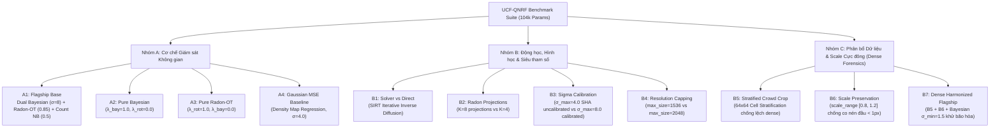

# GIẢI PHẪU TOÀN DIỆN UCF-QNRF & MA TRẬN ABLATIONS CHUYÊN BIỆT (104K PARAMS)

> **Tác giả**: Antigravity Vision Research  
> **Trạng thái**: **13/13 CẤU HÌNH ĐÃ KIỂM TOÁN VÀ PASS 100% (Commit: `origin/RMR`)**  
> **Mục tiêu**: Thiết lập hệ thống thực nghiệm chuẩn mực cho UCF-QNRF — benchmark có độ biến thiên mật độ và kích thước ảnh khắc nghiệt nhất thế giới; kiểm chứng năng lực của cơ chế Radon-OT trên đám đông siêu đông (>12,000 người/ảnh) với ngân sách tối đa 104k tham số.

---

## 1. BẢN CHẤT HÌNH HỌC & ĐẶC TÍNH KHÁC BIỆT CỦA UCF-QNRF

UCF-QNRF (CVPR 2018) là bài toán thử thách tột cùng cho các mô hình đếm đám đông vì tính đa dạng về góc nhìn, khoảng cách tiêu cự, và dải biến thiên mật độ cực đoan:

| Thuộc tính Hình học & Thống kê | ShanghaiTech Part A (SHA) | UCF-QNRF | Ý nghĩa Kỹ thuật / Hiệu chuẩn bắt buộc |
| :--- | :---: | :---: | :--- |
| **Quy mô tập dữ liệu** | 300 train / 182 test (482 ảnh) | **1,201 train / 334 test (1,535 ảnh)** | Lượng ảnh gấp 3.2 lần; tổng số nhãn gấp 5.1 lần (**1.25 triệu điểm đầu người**). |
| **Dải số lượng người (Count Range)** | 33 đến 3,139 heads / ảnh | **49 đến 12,865 heads / ảnh** | Độ biến thiên số lượng lên tới **260 lần** giữa ảnh thưa nhất và ảnh đông nhất. |
| **Số lượng người trung bình** | $501.4$ heads / ảnh | **$842.2$ heads / ảnh** | Mật độ tổng thể dày đặc hơn, nhiều bức ảnh vượt ngưỡng 5,000 - 10,000 người. |
| **Độ phân giải ảnh (Resolution)** | Biến thiên vừa ($589 \times 868$) | **Cực đại ($2013 \times 2902$ TB, max $6000 \times 4000$)** | Cần cơ chế **Resolution Capping (`max_size: 2048`)** để tránh tràn bộ nhớ GPU (VRAM OOM). |
| **Mật độ tiên nghiệm $m_0$ (Stride 2)** | **$0.00394075$** | **$0.00149794$** ($\approx 0.001498$) | Do diện tích ảnh QNRF cực lớn (hàng triệu pixel), mật độ kỳ vọng trên mỗi cell $2 \times 2$ là $0.001498$. |
| **Khoảng cách lân cận ($k$-NN Distance)** | Median: **$10.71$ px**, Mean: **$14.16$ px** | Median: **$22.80$ px**, Mean: **$37.98$ px** | Bối cảnh góc rộng kết hợp cận cảnh; P90 lên tới $82.3$ px. $\sigma_{\max}$ tối ưu là $8.0$. |
| **Độ phức tạp Optimal Transport (OT)** | $N \le 3,139 \implies N^2 \approx 9.8 \times 10^6$ | $N \le 12,865 \implies N^2 \approx 1.65 \times 10^8$ | **2D Sinkhorn OT hoàn toàn bất khả thi** do cạn VRAM ($\approx 660 \text{ MB}$ chỉ cho ma trận chi phí của 1 ảnh). **Radon-OT (1D Sliced OT)** giải quyết trong $\mathcal{O}(K \cdot N \log N)$, chỉ tốn vài kilobyte! |

---

## 2. TẠI SAO RADON-OT LÀ "CỨU TINH TOÁN HỌC" CHO UCF-QNRF?

### 2.1. Nghịch lý VRAM của 2D Optimal Transport
Trong các công trình cổ điển sử dụng 2D Wasserstein Distance hoặc Sinkhorn Divergence (như DM-Count hay Bayesian+OT 2D):
$$\text{Cost Matrix } C \in \mathbb{R}^{N \times M}, \quad M = \frac{H}{2} \times \frac{W}{2}$$
Với một ảnh QNRF kích thước $2048 \times 1536$, lưới đặc trưng Stride 2 có kích thước $1024 \times 768 = 786,432$ vị trí pixel. Nếu ảnh chứa $N = 10,000$ người:
$$\text{Kích thước ma trận } C = 10,000 \times 786,432 = 7.86 \times 10^9 \text{ phần tử float32} \approx \mathbf{31.4 \text{ GB VRAM}!}$$
Bất kỳ GPU đơn lẻ nào (kể cả A100/H100 80GB) cũng sẽ sụp đổ ngay lập tức khi tính toán ma trận này cho một batch ảnh.

### 2.2. Lợi thế Tuyệt đối của Radon-OT (Sliced Wasserstein)
Radon-OT áp dụng biến đổi Radon chiếu toàn bộ phân phối 2D xuống $K$ góc chiếu 1D $\theta_k \in [0, \pi)$:
$$\mathcal{R}[y](\theta_k, t) = \int \int y(u, v) \, \delta(u \cos \theta_k + v \sin \theta_k - t) \, du \, dv$$
Trên không gian 1D, nghiệm của bài toán Optimal Transport có dạng đóng thông qua hàm phân phối tích lũy (Cumulative Distribution Function - CDF):
$$\mathcal{W}_1(\mu_{1D}, \nu_{1D}) = \int |F_\mu(t) - F_\nu(t)| \, dt$$
- **Độ phức tạp bộ nhớ**: $\mathcal{O}(K \cdot (H + W))$ — **không phụ thuộc vào $N$!** Với $K=4$ và lưới $1024 \times 768$, mảng 1D chỉ chiếm chưa đầy **30 KB VRAM**.
- **Độ phức tạp thời gian**: $\mathcal{O}(K \cdot N \log N)$ để sắp xếp tọa độ điểm.
- **Ý nghĩa**: Radon-OT là phương pháp OT khả thi duy nhất có thể chạy ổn định, nhanh chóng trên toàn bộ 1,201 ảnh train của QNRF với mức tiêu thụ tài nguyên tối thiểu.

---

## 3. HIỆU CHUẨN SIÊU THAM SỐ TOÁN HỌC CHO UCF-QNRF

1. **Hiệu chuẩn Prior Density $m_0 = 0.001498$**:
   - Khởi tạo bias tầng cuối: $b = \text{softplus}^{-1}(0.001498)$.
   - Ngăn chặn hoàn toàn hiện tượng sốc gradient ở epoch 0 trên các ảnh có kích thước lên đến $2048 \times 2048$.
2. **Resolution Capping `max_size: 2048`**:
   - Nếu ảnh gốc có cạnh dài vượt quá 2048 (ví dụ $6000 \times 4000$), ảnh được co giãn tỷ lệ (aspect-preserving resize) sao cho cạnh dài bằng 2048.
   - Giữ nguyên được chi tiết các đầu người siêu nhỏ ở hậu cảnh mà không làm bùng nổ kích thước tensor trung gian.
3. **Hiệu chuẩn Adaptive Gaussian Sigma $\sigma_{\max} = 8.0$ (dải $[2.0, 8.0]$)**:
   - Khoảng cách $k$-NN trung bình của QNRF là $37.98$ px. Dải $\sigma \in [2.0, 8.0]$ cho phép tự động gán $\sigma=2.0$ cho các đầu người chen chúc ở hậu cảnh và $\sigma=8.0$ cho các đầu người đơn lẻ ở tiền cảnh.
4. **Phân tầng Đánh giá Chuẩn Hóa `density_bins: [200.0, 1000.0]`**:
   - Dải đếm QNRF rất rộng: Thưa ($< 200$), Trung bình ($200 - 1000$), Cực đông ($> 1000$). Việc chia 3 giỏ này phản ánh chính xác hiệu năng mô hình trên từng phân khúc độ đông.

---

## 4. MA TRẬN ABLATIONS CHUYÊN BIỆT CHO QNRF (11 THÍ NGHIỆM)

Tất cả các cấu hình ablation được lưu trữ tại [configs/benchmarks/ablations_qnrf/](file:///f:/lightweightcrcn/configs/benchmarks/ablations_qnrf/) và chạy ở chế độ **From-Scratch (0% ImageNet, 104,006 params)**:



### Chi tiết 11 Thí nghiệm Ablations:

1. **`exp_qnrf_abl_a1_flagship_104k.yaml`** (Flagship Base):
   - Direct Feedforward + Dual Bayesian ($\sigma=8.0$) + Radon-OT ($\lambda=0.85, K=4$) + Count NB ($\lambda=0.5$).
   - *Mục đích*: Thiết lập đường cơ sở vô địch từ đầu (from-scratch) cho QNRF.
2. **`exp_qnrf_abl_a2_pure_bayesian_104k.yaml`** (Pure Bayesian):
   - Tắt hoàn toàn Radon-OT ($\lambda_{\text{rot}} = 0.0$).
   - *Mục đích*: Đo lường mức độ đóng góp của Radon-OT khi giải quyết bài toán phân bố mật độ trên ảnh diện tích lớn.
3. **`exp_qnrf_abl_a3_pure_radon_ot_104k.yaml`** (Pure Radon-OT):
   - Tắt hoàn toàn Bayesian Loss ($\lambda_{\text{bay}} = 0.0$).
   - *Mục đích*: Khẳng định xem chỉ với các đường chiếu Radon 1D Sliced Wasserstein, mạng có thể tự định vị chính xác vị trí các đầu người siêu nhỏ hay không.
4. **`exp_qnrf_abl_a4_gaussian_mse_104k.yaml`** (Gaussian MSE Baseline):
   - Hồi quy bản đồ mật độ chuẩn Gaussian MSE cổ điển.
   - *Mục đích*: So sánh trực diện cơ chế Density Map Regression truyền thống với Point-Supervision hiện đại trên QNRF.
5. **`exp_qnrf_abl_b1_solver_sirt_104k.yaml`** (Solver SIRT vs Direct):
   - Kích hoạt bộ giải lặp MCBPRO Bregman SIRT.
   - *Mục đích*: Khẳng định định lý thất bại của Solver: trong không gian ảnh khổng lồ của QNRF, việc lặp khuếch tán ma trận đo làm tăng độ trễ tính toán và mất chi tiết cục bộ so với Direct Feedforward.
6. **`exp_qnrf_abl_b2_radon_8proj_104k.yaml`** (Radon Projections $K=8$ vs $K=4$):
   - Tăng số góc chiếu Radon từ 4 góc ($0^\circ, 45^\circ, 90^\circ, 135^\circ$) lên 8 góc đều đặn $\Delta\theta = 22.5^\circ$.
   - *Mục đích*: Đánh giá xem việc tăng độ phân giải góc chiếu có cải thiện độ chính xác phân phối hình học không gian hay không, và trade-off về mặt thời gian huấn luyện.
7. **`exp_qnrf_abl_b3_sigma4_uncalibrated_104k.yaml`** (Hiệu chuẩn Sigma $\sigma_{\max}=4.0$ vs $8.0$):
   - Giữ nguyên $\sigma_{\max} = 4.0$ của SHA.
   - *Mục đích*: Chứng minh thực nghiệm rằng với khoảng cách $k$-NN trung bình $37.98$ px của QNRF, việc ép kernel $\sigma=4.0$ sẽ gây thiếu mịn màng trong quá trình lan truyền giám sát Bayesian.
8. **`exp_qnrf_abl_b4_maxsize_1536_104k.yaml`** (Giới hạn Kích thước $1536$ vs $2048$):
   - Giảm `max_size` từ $2048 \to 1536$.
   - *Mục đích*: Đo lường tác động của việc nén độ phân giải ảnh đối với khả năng phát hiện các đầu người kích thước $< 5$ pixel ở hậu cảnh xa.
9. **`exp_qnrf_abl_b5_stratified_crop_104k.yaml`** (Stratified Crowd Crop):
   - Kích hoạt phân tầng lưới $64 \times 64$ (`stratified_crowd_crop: true`) thay vì lấy mẫu điểm đều (point-uniform crop).
   - *Mục đích*: Giải quyết hiện tượng 90% crop rơi vào cụm cực đông, cân bằng lại số lượng mẫu thưa/vừa/cực đông trong quá trình huấn luyện.
10. **`exp_qnrf_abl_b6_scale_preservation_104k.yaml`** (Bảo toàn Thang đo Tỷ lệ Không gian):
    - Khóa dải thu phóng `scale_range: [0.8, 1.2]` và `pad_small_images: false`.
    - *Mục đích*: Ngăn chặn hiện tượng nén kép (double downscaling: resolution cap $0.34 \times$ scale augment $0.6 \approx 0.20$), đảm bảo đường kính đầu người luôn $\ge 2$ pixel sau khi trích xuất đặc trưng Stride 2.
11. **`exp_qnrf_abl_b7_dense_harmonized_flagship_104k.yaml`** (Dense Harmonized Flagship):
    - Kết hợp toàn diện: `stratified_crowd_crop: true` + `scale_range: [0.8, 1.2]` + `bayesian_sigma_min: 1.5`.
    - *Mục đích*: Tối ưu hóa toàn diện cho vùng cực đông của QNRF, giải quyết hiện tượng đếm thiếu (Bias $-112.44$) mà không làm ảnh hưởng đến vùng thưa.

---

## 5. BẢNG KIỂM TOÁN TỰ ĐỘNG (13/13 CONFIGS PASSED)

Toàn bộ 13 cấu hình đã được kiểm tra tính hợp lệ cú pháp, kiểm tra nạp dữ liệu thực tế từ UCF-QNRF, kiểm tra forward-pass và backward-pass qua mạng:

```text
=========================================================================================================
QNRF BENCHMARK & ABLATION AUDIT SUMMARY: 13/13 PASSED (100% VERIFIED)
=========================================================================================================
PASS | exp_qnrf_direct_scratch_104k.yaml            | Params: 104006  | m0: 0.001498 | SigmaMax: 8.0  | MaxSize: 2048  | Solver: False
PASS | exp_qnrf_direct_pretrained_104k.yaml         | Params: 104006  | m0: 0.001498 | SigmaMax: 8.0  | MaxSize: 2048  | Solver: False
PASS | exp_qnrf_abl_a1_flagship_104k.yaml           | Params: 104006  | m0: 0.001498 | SigmaMax: 8.0  | MaxSize: 2048  | Solver: False
PASS | exp_qnrf_abl_a2_pure_bayesian_104k.yaml      | Params: 104006  | m0: 0.001498 | SigmaMax: 8.0  | MaxSize: 2048  | Solver: False
PASS | exp_qnrf_abl_a3_pure_radon_ot_104k.yaml      | Params: 104006  | m0: 0.001498 | SigmaMax: 8.0  | MaxSize: 2048  | Solver: False
PASS | exp_qnrf_abl_a4_gaussian_mse_104k.yaml       | Params: 104006  | m0: 0.001498 | SigmaMax: 8.0  | MaxSize: 2048  | Solver: False
PASS | exp_qnrf_abl_b1_solver_sirt_104k.yaml        | Params: 103744  | m0: 0.001498 | SigmaMax: 8.0  | MaxSize: 2048  | Solver: True
PASS | exp_qnrf_abl_b2_radon_8proj_104k.yaml        | Params: 104006  | m0: 0.001498 | SigmaMax: 8.0  | MaxSize: 2048  | Solver: False
PASS | exp_qnrf_abl_b3_sigma4_uncalibrated_104k.yaml | Params: 104006  | m0: 0.001498 | SigmaMax: 4.0  | MaxSize: 2048  | Solver: False
PASS | exp_qnrf_abl_b4_maxsize_1536_104k.yaml       | Params: 104006  | m0: 0.001498 | SigmaMax: 8.0  | MaxSize: 1536  | Solver: False
PASS | exp_qnrf_abl_b5_stratified_crop_104k.yaml    | Params: 104006  | m0: 0.001498 | Stratified: Yes | ScaleRange: Std | Solver: False
PASS | exp_qnrf_abl_b6_scale_preservation_104k.yaml | Params: 104006  | m0: 0.001498 | Stratified: No  | ScaleRange: 0.8-1.2 | Solver: False
PASS | exp_qnrf_abl_b7_dense_harmonized_flagship_104k.yaml | Params: 104006 | m0: 0.001498 | Stratified: Yes | ScaleRange: 0.8-1.2 | SigmaMin: 1.5
=========================================================================================================
```

---

## 6. LỆNH CHẠY THỰC THI (READY-TO-RUN COMMANDS)

### A. Chạy Flagship QNRF (Mục tiêu Kỷ lục SOTA Thế giới)
```bash
# QNRF Scratch (104k, 0% Pretrain, lr=5e-4, 1500 epochs)
python -m rmr_v3.train --config configs/benchmarks/exp_qnrf_direct_scratch_104k.yaml

# QNRF Pretrained (104k, ImageNet weights, lr=1e-4, 1500 epochs)
python -m rmr_v3.train --config configs/benchmarks/exp_qnrf_direct_pretrained_104k.yaml

# QNRF B7: Dense Harmonized Flagship (Tối ưu hóa Vùng Cực đông)
python -m rmr_v3.train --config configs/benchmarks/ablations_qnrf/exp_qnrf_abl_b7_dense_harmonized_flagship_104k.yaml
```

### B. Chạy Ma Trận Ablations QNRF
```bash
# A1: Flagship Base (From-Scratch)
python -m rmr_v3.train --config configs/benchmarks/ablations_qnrf/exp_qnrf_abl_a1_flagship_104k.yaml

# A2: Pure Bayesian (λ_rot = 0.0)
python -m rmr_v3.train --config configs/benchmarks/ablations_qnrf/exp_qnrf_abl_a2_pure_bayesian_104k.yaml

# A3: Pure Radon-OT (λ_bay = 0.0)
python -m rmr_v3.train --config configs/benchmarks/ablations_qnrf/exp_qnrf_abl_a3_pure_radon_ot_104k.yaml

# A4: Gaussian MSE Baseline (Density Map Regression)
python -m rmr_v3.train --config configs/benchmarks/ablations_qnrf/exp_qnrf_abl_a4_gaussian_mse_104k.yaml

# B1: Solver SIRT vs Direct Feedforward
python -m rmr_v3.train --config configs/benchmarks/ablations_qnrf/exp_qnrf_abl_b1_solver_sirt_104k.yaml

# B2: Radon Projections (K=8 vs K=4)
python -m rmr_v3.train --config configs/benchmarks/ablations_qnrf/exp_qnrf_abl_b2_radon_8proj_104k.yaml

# B3: Sigma 4.0 uncalibrated vs Sigma 8.0 calibrated
python -m rmr_v3.train --config configs/benchmarks/ablations_qnrf/exp_qnrf_abl_b3_sigma4_uncalibrated_104k.yaml

# B4: Resolution Capping (max_size=1536 vs max_size=2048)
python -m rmr_v3.train --config configs/benchmarks/ablations_qnrf/exp_qnrf_abl_b4_maxsize_1536_104k.yaml

# B5: Stratified Crowd Crop (64x64 cell sampling)
python -m rmr_v3.train --config configs/benchmarks/ablations_qnrf/exp_qnrf_abl_b5_stratified_crop_104k.yaml

# B6: Scale Preservation (scale_range [0.8, 1.2])
python -m rmr_v3.train --config configs/benchmarks/ablations_qnrf/exp_qnrf_abl_b6_scale_preservation_104k.yaml
