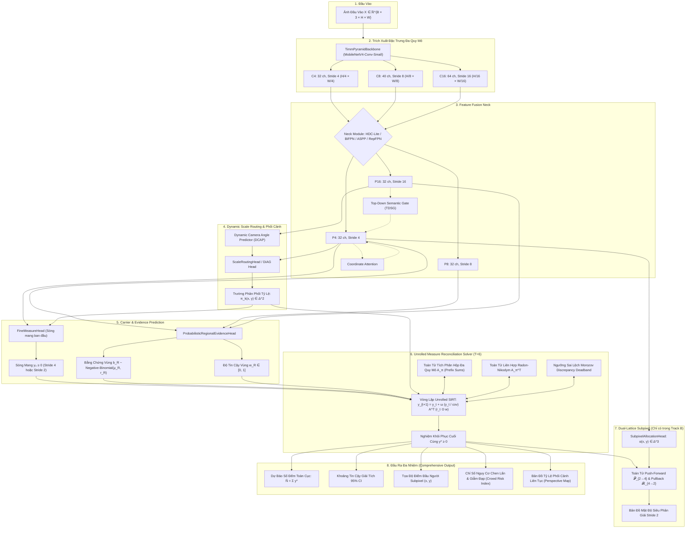
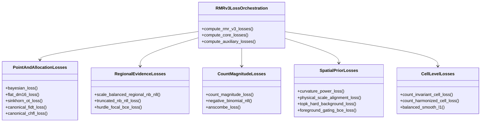

# TỔNG MỤC CÁC THÀNH PHẦN KIẾN TRÚC MÔ HÌNH RMR (RADON MEASURE RECOVERY)
## Bản Đặc Tả Kỹ Thuật Toàn Diện 100% Components - Không Bỏ Sót

> [!IMPORTANT]
> **Định chế mô hình**: Mô hình RMR (Radon Measure Recovery) giải quyết bài toán đếm đám đông dưới dạng **Bài toán nghịch đảo Fredholm loại 1** ($b = A_{\pi} y + \eta$) trên độ đo Radon không âm. Toàn bộ kiến trúc được xây dựng theo 2 track chuẩn:
> - **Track A (Canonical Stride 4)**: Cố định tuyệt đối $\le 104,441$ tham số (hiện tại đạt đúng **104,441** tham số), 100% Standalone (0.0% Knowledge Distillation).
> - **Track B (Dual-Lattice Subpixel Stride 2)**: Mở rộng ngân sách $\le 200,000$ tham số (hiện tại đạt **152,755** tham số), kết hợp trường sóng mang Stride 2 và toán tử co cụm Push-Forward bảo toàn khối lượng $\mathcal{P}_{2 \to 4}$.

---

## 1. Sơ Đồ Khối Tổng Quan Hệ Thống (End-to-End System Architecture)

---

## 2. Bảng Phân Bổ Ngân Sách Tham Số Tuyệt Đối (Parameter Budget Allocation)

| Phân Cụm Thành Phần | Module Triển Khai | Lớp Cụ Thể | Track A (Stride 4) | Track B (Subpixel 2) | File Mã Nguồn |
| :--- | :--- | :--- | :--- | :--- | :--- |
| **Backbone Encoder** | `encoder` | `TimmPyramidBackbone` (`mobilenetv4_conv_small_050`) | **87,568** (83.8%) | **87,568** (57.3%) | [`rmr_core/backbones.py`](file:///f:/lightweightcrcn/rmr_core/backbones.py) |
| **Feature Fusion Neck** | `fusion` | `HDCLiteFPNNeck` (A) / `BiFPNLiteNeck` (B) | **10,784** (10.3%) | **30,410** (19.9%) | [`rmr_core/necks/`](file:///f:/lightweightcrcn/rmr_core/necks/) |
| **Fine Density Head** | `fine_head` | `FineMeasureHead` (Softplus / ReLU) | **1,475** (1.4%) | **4,995** (3.3%) | [`rmr_core/heads.py`](file:///f:/lightweightcrcn/rmr_core/heads.py) |
| **Regional Evidence Head** | `region_head` | `ProbabilisticRegionalEvidenceHead` | **4,131** (4.0%) | **25,347** (16.6%) | [`rmr_v3/regional_head.py`](file:///f:/lightweightcrcn/rmr_v3/regional_head.py) |
| **Scale Routing Head** | `scale_router` | `ScaleRoutingHead` / `DiAGScaleRoutingHead` | **483** (0.5%) | **963** (0.6%) | [`rmr_core/scale_routing.py`](file:///f:/lightweightcrcn/rmr_core/scale_routing.py) |
| **Subpixel Allocator** | `subpixel_allocator` | `SubpixelAllocationHead` | **0** (Disabled) | **3,460** (2.3%) | [`rmr_v3/model/dual_lattice.py`](file:///f:/lightweightcrcn/rmr_v3/model/dual_lattice.py) |
| **Learned Solver Steps** | `learned_omega/gamma` | `nn.Parameter` ($T$ steps) | **0** (hoặc 12) | **12** (0.01%) | [`rmr_v3/model/architecture.py`](file:///f:/lightweightcrcn/rmr_v3/model/architecture.py) |
| **Auxiliary Gating** | `fg_gate` / `tdsg` | `Conv2d(32, 1, 1)` | Tuỳ chọn (33 / 66) | Tuỳ chọn (33 / 66) | [`rmr_v3/model/builder.py`](file:///f:/lightweightcrcn/rmr_v3/model/builder.py) |
| **TỔNG THAM SỐ TOÀN MẠNG** | **Toàn Bộ Mô Hình** | `RMRv3` | **104,441 / 104,441** | **152,755 / 200,000** | [`rmr_v3/model/canonical.py`](file:///f:/lightweightcrcn/rmr_v3/model/canonical.py) |

---

## 3. Danh Mục Chi Tiết Từng Thành Phần (Exhaustive Component Breakdown)

### 3.1. Trục Trích Xuất Đặc Trưng (Backbone & Encoder)
- **Tên Class**: [`TimmPyramidBackbone`](file:///f:/lightweightcrcn/rmr_core/backbones.py#L10)
- **File định nghĩa**: [`rmr_core/backbones.py`](file:///f:/lightweightcrcn/rmr_core/backbones.py)
- **Kiến trúc cốt lõi**: `mobilenetv4_conv_small_050.e3000_r224_in1k` (Ross Wightman, Google Research ECCV 2024).
- **Cơ chế**:
  * Trích xuất đa tầng kim tự tháp tại các mức giảm độ phân giải `target_reductions = (4, 8, 16)`.
  * Cắt bỏ toàn bộ tầng classifier và norm_head phía sau C16 để tiết kiệm ngân sách tham số.
- **Kích thước Tensor**:
  * Đầu vào: $X \in \mathbb{R}^{B \times 3 \times H \times W}$.
  * $C_4 \in \mathbb{R}^{B \times 32 \times \frac{H}{4} \times \frac{W}{4}}$ (Stage 1 / UIB blocks).
  * $C_8 \in \mathbb{R}^{B \times 40 \times \frac{H}{8} \times \frac{W}{8}}$ (Stage 2).
  * $C_{16} \in \mathbb{R}^{B \times 64 \times \frac{H}{16} \times \frac{W}{16}}$ (Stage 3).
- **Số lượng tham số**: **87,568** tham số.

---

### 3.2. Cụm Feature Fusion Necks (`rmr_core/necks/`)
Toàn bộ họ các Neck được thiết kế chuẩn hoá để đưa các tầng đặc trưng $C_4, C_8, C_16$ về cùng độ rộng kênh `feature_width` ($D=32$ ở Track A, $D=40$ hoặc $48$ ở Track B).

#### 1. HDCLiteFPNNeck (Neck Mặc Định Champion Track A)
- **File**: [`rmr_core/necks/hdc.py`](file:///f:/lightweightcrcn/rmr_core/necks/hdc.py)
- **Class**: [`HDCLiteFPNNeck`](file:///f:/lightweightcrcn/rmr_core/necks/hdc.py#L9)
- **Toán học & Cơ chế**:
  * **Hybrid Dilated Cascade (HDC)** trên tầng sâu nhất $P_{16}$ với chuỗi giãn nở $d \in \{1, 2, 3\}$.
  * Định lý Wang et al.: Tổng khoảng cách giãn nở cực đại $M_i = \max(M_{i+1} - 2d_i, M_{i+1} - 2(M_{i+1}-d_i), d_i) \le K$ giúp triệt tiêu hoàn toàn hiện tượng **Gridding Artifacts** (lỗ thủng thông tin khi dilation lớn).
  * Chiếu ngang lateral $1 \times 1$ convs kết hợp làm mịn Smooth DW-Convs $3 \times 3$ với GroupNorm ($G=8$).
- **Số tham số**: **10,784** params (vừa khít đưa tổng mô hình đạt đúng 104,441).
- **Đầu ra**: $P_4, P_8, P_{16} \in \mathbb{R}^{B \times 32 \times H_i \times W_i}$.

#### 2. BiFPNLiteNeck (Neck Đa Chiều Nâng Cao Track B)
- **File**: [`rmr_core/necks/bifpn.py`](file:///f:/lightweightcrcn/rmr_core/necks/bifpn.py)
- **Class**: [`BiFPNLiteNeck`](file:///f:/lightweightcrcn/rmr_core/necks/bifpn.py#L12)
- **Toán học & Cơ chế**:
  * Hòa trộn 2 chiều (Bidirectional Top-Down và Bottom-Up Fusion) lấy cảm hứng từ EfficientDet (Tan et al.).
  * **Fast Normalized Fusion Weights**:
    $$O = \sum_i \frac{w_i}{\epsilon + \sum_j w_j} \cdot I_i, \quad w_i = \text{ReLU}(w_i^{\text{raw}})$$
  * Khối biến đổi Depthwise Separable ResBlocks (`DSResidual`) tăng cường năng lực phi tuyến.
- **Số tham số**: **30,410** params (ở width=32) hoặc 45k params (ở width=40).

#### 3. ASPPLiteFPNNeck (Atrous Spatial Pyramid Pooling Neck)
- **File**: [`rmr_core/necks/aspp.py`](file:///f:/lightweightcrcn/rmr_core/necks/aspp.py)
- **Class**: [`ASPPLiteFPNNeck`](file:///f:/lightweightcrcn/rmr_core/necks/aspp.py#L10)
- **Cơ chế**:
  * Phân nhánh đa tỷ lệ trên $P_{16}$: $1 \times 1$ conv, $3 \times 3$ atrous conv với dilations $[1, 3, 6]$, và nhánh Global Average Pooling (GAP).
  * Chiếu top-down xuống $P_8$ và $P_4$.
- **Số tham số**: **8,224** params.

#### 4. RepWeightedFPNNeck & RepDWBlock7x7 (Structural Re-parameterization)
- **File**: [`rmr_core/necks/rep_fpn.py`](file:///f:/lightweightcrcn/rmr_core/necks/rep_fpn.py)
- **Classes**: [`RepWeightedFPNNeck`](file:///f:/lightweightcrcn/rmr_core/necks/rep_fpn.py#L60), [`RepDWBlock7x7`](file:///f:/lightweightcrcn/rmr_core/necks/rep_fpn.py#L9)
- **Cơ chế Re-parameterization**:
  * Khi huấn luyện: Gồm 3 nhánh song song: DW-Conv $7 \times 7$, DW-Conv $3 \times 3$, và DW-Conv $1 \times 1$ cùng nhánh Identity.
  * Khi kiểm thử/triển khai (`switch_to_deploy`): Đại số tuyến tính gộp toàn bộ ma trận trọng số và bias của các nhánh vào **1 kernel $7 \times 7$ duy nhất**:
    $$W_{\text{deploy}} = W_{7\times7} + \text{Pad}(W_{3\times3}) + \text{Pad}(W_{1\times1}) + \text{Pad}(I)$$
  * Đạt tốc độ inference cực đại và 0 overhead độ trễ khi triển khai.

#### 5. AdditiveFPNNeck & AdditiveFusion
- **File**: [`rmr_core/necks/additive.py`](file:///f:/lightweightcrcn/rmr_core/necks/additive.py)
- **Classes**: [`AdditiveFPNNeck`](file:///f:/lightweightcrcn/rmr_core/necks/additive.py#L42), [`AdditiveFusion`](file:///f:/lightweightcrcn/rmr_core/necks/additive.py#L9)
- **Cơ chế**: Top-down FPN kinh điển với phép cộng lateral đơn giản, phù hợp cho baseline siêu tối giản.

#### 6. Các Khối Xây Dựng Cơ Bản Của Neck (`rmr_core/necks/blocks.py`)
- **File**: [`rmr_core/necks/blocks.py`](file:///f:/lightweightcrcn/rmr_core/necks/blocks.py)
- [`ConvGNAct`](file:///f:/lightweightcrcn/rmr_core/necks/blocks.py#L18): `Conv2d` + `GroupNorm(G=8)` + `SiLU` (hỗ trợ depthwise qua `groups=C`).
- [`TinyIR`](file:///f:/lightweightcrcn/rmr_core/necks/blocks.py#L38): Khối Inverted Residual thu nhỏ (PW-Expand $\to$ DW-Conv $\to$ PW-Project + Residual).
- [`DSResidual`](file:///f:/lightweightcrcn/rmr_core/necks/blocks.py#L55): Khối Depthwise Separable Conv với skip-connection.
- [`DepthwiseDilated`](file:///f:/lightweightcrcn/rmr_core/necks/blocks.py#L70): Depthwise Conv với dilation tùy biến + Pointwise projection.
- [`CoordinateAttention`](file:///f:/lightweightcrcn/rmr_core/necks/attention.py#L9): Khối chú ý tọa độ độc lập 2 trục $X$ và $Y$ (Hou et al., CVPR 2021) mã hóa vị trí không gian chính xác vào kênh đặc trưng.

---

### 3.3. Nhánh Sóng Mang Mật Độ Tinh (Fine Density / Carrier Heads)
- **File định nghĩa**: [`rmr_core/heads.py`](file:///f:/lightweightcrcn/rmr_core/heads.py) & [`rmr_core/density_activation.py`](file:///f:/lightweightcrcn/rmr_core/density_activation.py)
- **Classes**: [`FineMeasureHead`](file:///f:/lightweightcrcn/rmr_core/heads.py#L30), [`ScaleConditionedFineHead`](file:///f:/lightweightcrcn/rmr_core/heads.py#L295)

#### 1. Cấu Trúc Lớp & Tham Số
- Đầu vào: Đặc trưng $P_4 \in \mathbb{R}^{B \times 32 \times \frac{H}{4} \times \frac{W}{4}}$.
- Kiến trúc mạng nơ-ron:
  1. `ConvGNAct(32, 32, kernel=3, groups=32)` (DW-Conv trích xuất không gian).
  2. `ConvGNAct(32, 32, kernel=1)` (Pointwise Conv pha trộn kênh).
  3. `nn.Conv2d(32, out_channels, kernel=1)` (Chiếu ra logit $z_0$, với `out_channels=1` cho Stride 4, hoặc `out_channels=4` cho Subpixel Stride 2 kèm `PixelShuffle(2)`).
- Số tham số: **1,475** params (Stride 4) hoặc **4,995** params (Subpixel Stride 2).

#### 2. Các Toán Tử Kích Hoạt & Cân Chỉnh (Activation Operators)
- **Khởi Tạo Tiên Đề Dựa Trên Dữ Liệu (Data-Driven Bias Initialization)**:
  Tỷ lệ mật độ trung bình trên toàn tập huấn luyện ShanghaiTech Part A:
  $$m_0 = \frac{\text{Tổng số người}}{\text{Tổng số cell Stride 4}} \approx 0.015763 \text{ người/cell}$$
  Bias của lớp conv cuối được khởi tạo chính xác:
  $$\text{bias}_{\text{init}} = \text{softplus}^{-1}(m_0) = \ln(e^{m_0} - 1) \approx -4.1422$$
  Tránh hiện tượng bùng nổ gradient ở các epoch đầu tiên.
- **Scale Prior Boost**:
  $$z_{\text{boost}}(x, y) = z_0(x, y) + \beta_{\text{prior}} \sum_{k=1}^K \pi_k(x, y) \cdot s_k$$
  Nâng logit mật độ lên một cách tự nhiên ở vùng được bộ định tuyến nhận diện là đầu người nhỏ dày đặc.
- **Density Curvature Warping**:
  Giải quyết bão hòa mật độ ở các cell có $\ge 2$ người ($y_0 \ge 1.0$) bằng cơ chế cổng phi tuyến:
  $$\text{gate}(x, y) = \sigma\left(\frac{\text{LocalPool}(y_0) - \theta_{\text{dense}}}{\beta_{\text{gate}}}\right)$$
  $$y_{\text{warped}} = y_0 + \text{gate} \cdot \alpha \cdot y_0^2$$
- **Density Adaptive Scale**:
  $$y = y_0 \cdot (1 + \gamma_{\text{scale}} \cdot \text{ReLU}(z_0))$$
- **Smooth Floor Tau ($\tau$)**:
  $$y_{\text{floored}} = \begin{cases} y - \frac{\tau}{2}, & \text{khi } y > \tau \\ \frac{y^2}{2\tau}, & \text{khi } 0 \le y \le \tau \end{cases}$$
  Triệt tiêu hoàn toàn nhiễu nền rỗng (False Positives) mà vẫn đảm bảo tính khả vi liên tục $C^1$.

---

### 3.4. Nhánh Bằng Chứng Số Đếm Vùng (Regional Evidence Heads)
- **File định nghĩa**: [`rmr_v3/regional_head.py`](file:///f:/lightweightcrcn/rmr_v3/regional_head.py)
- **Class**: [`ProbabilisticRegionalEvidenceHead`](file:///f:/lightweightcrcn/rmr_v3/regional_head.py#L37)
- **Toán học & Mô hình xác suất**:
  Mô hình hóa số lượng người trong mỗi hộp quan sát $R \in \mathcal{R}$ theo phân phối **Negative-Binomial (NB)** hai thông số $(\mu_R, r_R)$:
  $$\mathbb{P}(Y_R = k) = \frac{\Gamma(k + r_R)}{k! \, \Gamma(r_R)} \left(\frac{r_R}{\mu_R + r_R}\right)^{r_R} \left(\frac{\mu_R}{\mu_R + r_R}\right)^k$$
  Phương sai lý thuyết: $\sigma_R^2 = \text{Var}(Y_R) = \mu_R + \frac{\mu_R^2}{r_R}$.

#### 1. Cấu Trúc Các Nhánh Con (Sub-Heads)
- **Feature Trunk**: 2-layer MLP với `GroupNorm(8)` và `SiLU` chiếu đặc trưng vùng gộp từ $P_4, P_8, P_{16}$.
- **Mean Rate Head (`mean_head`)**: Dự đoán tỷ lệ mật độ vùng $\text{rate}_R > 0$ qua Softplus/ReLU. Số đếm kỳ vọng:
  $$\mu_R = |R| \cdot \text{rate}_R$$
- **Log Dispersion Head (`log_dispersion_head`)**: Dự đoán thông số phân tán $r_R = \exp(\text{clamp}(\log r, -3.0, 7.0))$. Khi $r_R \to \infty$, phân phối NB hội tụ về Poisson ($\sigma_R^2 = \mu_R$). Khi đám đông biến thiên mạnh, $r_R$ nhỏ thể hiện phương sai lớn (Overdispersion).
- **Hurdle Occupancy Head (`hurdle_head_layer`)**: Dự đoán xác suất hộp có người $\pi_R = \sigma(z_{\pi, R})$ theo mô hình Two-Part Hurdle.
- **Scale Attention / Projection**: Hòa trộn đặc trưng tương ứng với từng kích thước hộp $[32, 64, 128]$ px.
- **Số tham số**: **4,131** params (Track A) hoặc **25,347** params (Track B khi mở rộng MLP trunk lên 64 kênh).

#### 2. Độ Tin Cậy Vùng Giải Tích (Analytical Regional Reliability $w_R$)
Hàm [`reliability_from_nb`](file:///f:/lightweightcrcn/rmr_v3/regional_head.py#L22) chuyển hóa phân phối NB thành trọng số tin cậy $w_R \in [0, 1]$ cho bộ giải nghịch đảo:
1. **SNR Reliability Mode**:
   $$w_R = \frac{\mu_R}{\sigma_R} = \frac{\mu_R}{\sqrt{\mu_R + \mu_R^2 / r_R}} = \frac{1}{\sqrt{1/\mu_R + 1/r_R}}$$
2. **Variance-Damped Mode**:
   $$w_R = \exp\left(-\beta \frac{\sigma_R^2}{\mu_R + \epsilon}\right) = \exp\left(-\beta \left(1 + \frac{\mu_R}{r_R}\right)\right)$$
3. **Hurdle Occupancy Coupling**:
   $$w_R^{\text{final}} = \pi_R \cdot w_R$$

---

### 3.5. Bộ Định Tuyến Tỷ Lệ Động & Hình Học Phối Cảnh (Scale Routing & Perspective)
- **File**: [`rmr_core/scale_routing.py`](file:///f:/lightweightcrcn/rmr_core/scale_routing.py) & [`rmr_v3/model/perspective_geometry.py`](file:///f:/lightweightcrcn/rmr_v3/model/perspective_geometry.py)

#### 1. ScaleRoutingHead (Mặc định)
- **Class**: [`ScaleRoutingHead`](file:///f:/lightweightcrcn/rmr_core/scale_routing.py#L18)
- **Cơ chế**: Gồm `ConvGNAct(32, 32, kernel=3, groups=32)` + `nn.Conv2d(32, K, 1)` + `Softmax(dim=1)` tính xác suất phân bổ tỷ lệ $\pi_k(x, y) \in \Delta^{K-1}$ cho từng pixel trên lưới Stride 4.
- **Số tham số**: **483** params (K=3) hoặc **963** params (K=6).

#### 2. DynamicCameraAnglePredictor (DCAP)
- **Class**: [`DynamicCameraAnglePredictor`](file:///f:/lightweightcrcn/rmr_v3/model/perspective_geometry.py#L18)
- **Toán học & Cơ chế**:
  * Nhận đặc trưng ngữ nghĩa toàn cục $P_{16}$, nén qua Global Average Pooling (GAP).
  * MLP dự đoán 2 thông số hình học máy ảnh của cảnh:
    1. Góc nghiêng cảnh $\theta_{\text{tilt}} = \tanh(\text{linear}_1) \in [-1, 1]$.
    2. Độ dịch chuyển tỷ lệ toàn cục $\delta_{\text{scale}} = \tanh(\text{linear}_2) \in [-1, 1]$.
  * 100% tự học từ đặc trưng ảnh, **tuyệt đối không dùng tọa độ giả lập linspace (x, y)** nên không bao giờ bị méo mó khi Random Crop.
- **Số tham số**: **1,090** params.

#### 3. DiAGScaleRoutingHead & DiAGFactorizedRoutingHead
- **Classes**: [`DiAGScaleRoutingHead`](file:///f:/lightweightcrcn/rmr_v3/model/perspective_geometry.py#L48), [`DiAGFactorizedRoutingHead`](file:///f:/lightweightcrcn/rmr_v3/model/perspective_geometry.py#L90)
- **Cơ chế Factorized Marginals**:
  Phân rã xác suất chọn kích thước cửa sổ thành 2 phân phối độc lập:
  $$\pi_{\text{window}}(s, a) = \pi_{\text{scale}}(s) \otimes \pi_{\text{aspect}}(a)$$
  * $\pi_{\text{scale}} \in \Delta^2$ biểu diễn 3 thang kích thước: Nhỏ ($32\text{px}$), Vừa ($64\text{px}$), Lớn ($128\text{px}$).
  * $\pi_{\text{aspect}} \in \Delta^1$ biểu diễn tỷ lệ khung hình: Vuông ($1:1$) và Dẹt ($2:1$).
  * Tạo thành từ điển 4 cửa sổ quan sát: $[32 \times 32, 64 \times 64, 64 \times 32, 128 \times 128]$.

---

### 3.6. Tái Cấu Trúc Subpixel & Lưới Kép (Dual-Lattice Subpixel Stride 2)
- **File**: [`rmr_v3/model/dual_lattice.py`](file:///f:/lightweightcrcn/rmr_v3/model/dual_lattice.py)

#### 1. SubpixelAllocationHead
- **Class**: [`SubpixelAllocationHead`](file:///f:/lightweightcrcn/rmr_v3/model/dual_lattice.py#L15)
- **Cơ chế**: Nhận đặc trưng $P_4$ (32 kênh), dự đoán ma trận phân bổ $2 \times 2$ có trọng số dương và chuẩn hóa tổng bằng 1 qua Softmax:
  $$\alpha(x, y) = \text{Softmax}\left(\text{Conv}_{3\times3}(P_4)\right) \in \Delta^3, \quad \sum_{i=1}^4 \alpha_i(x, y) = 1.0$$
- **Số tham số**: **3,460** params (với kernel $3 \times 3$).

#### 2. Các Toán Tử Lưới Kép Bảo Toàn Khối Lượng
- [`push_forward_stride2_to_stride4`](file:///f:/lightweightcrcn/rmr_v3/model/dual_lattice.py#L49):
  Toán tử đẩy tới từ lưới mịn Stride 2 sang lưới thô Stride 4:
  $$\mathcal{P}_{2 \to 4}(y_2) = \text{AvgPool2d}(y_2, \text{kernel}=2, \text{stride}=2) \times 4.0$$
  Chứng minh bảo toàn khối lượng:
  $$\sum_{u, v} \mathcal{P}_{2 \to 4}(y_2)[u, v] \equiv \sum_{x, y} y_2[x, y]$$
- [`pullback_stride4_to_stride2_rn`](file:///f:/lightweightcrcn/rmr_v3/model/dual_lattice.py#L71):
  Toán tử kéo ngược Radon-Nikodym điều biến mật độ Stride 4 về Stride 2 thông qua ma trận phân bổ $\alpha$:
  $$y_2(2x + i, 2y + j) = y_4(x, y) \cdot \alpha_{i, j}(x, y), \quad i, j \in \{0, 1\}$$
- [`scale_regions_to_stride2`](file:///f:/lightweightcrcn/rmr_v3/model/dual_lattice.py#L112):
  Nhân đôi tọa độ hộp quan sát từ lưới Stride 4 sang lưới Stride 2 để bộ giải SIRT chạy trực tiếp ở độ phân giải $256 \times 256$.

---

### 3.7. Cửa Sổ Quan Sát & Toán Tử Tích Phân Không Gian (`rmr_core/operators/`)

#### 1. RegionSet & Multiscale Regions
- **File**: [`rmr_core/operators/regions.py`](file:///f:/lightweightcrcn/rmr_core/operators/regions.py)
- **Class**: [`RegionSet`](file:///f:/lightweightcrcn/rmr_core/operators/regions.py#L14)
- **Cấu trúc hộp**: Tập hợp $M = 1,235$ hộp hình chữ nhật đa quy mô (với ảnh $512 \times 512$):
  * Thang 1: Hộp $32 \times 32\text{px}$ (ở Stride 4 là $8 \times 8$ cells), bước trượt stride 4 cells ($50\%$ overlap).
  * Thang 2: Hộp $64 \times 64\text{px}$ (ở Stride 4 là $16 \times 16$ cells), bước trượt stride 8 cells.
  * Thang 3: Hộp $128 \times 128\text{px}$ (ở Stride 4 là $32 \times 32$ cells), bước trượt stride 16 cells.
- [`build_multiscale_regions`](file:///f:/lightweightcrcn/rmr_core/operators/regions.py#L90): Tạo tọa độ hộp $(x_1, y_1, x_2, y_2)$, scale IDs, diện tích hộp có bộ nhớ đệm LRU Cache.

#### 2. Toán Tử Tích Phân Hộp Song Song Qua Prefix Sums
- **File**: [`rmr_core/operators/prefix_sums.py`](file:///f:/lightweightcrcn/rmr_core/operators/prefix_sums.py)
- [`prefix2d`](file:///f:/lightweightcrcn/rmr_core/operators/prefix_sums.py#L10): Tính bảng tiền tố 2D tích lũy $S[i, j] = \sum_{u \le i, v \le j} y[u, v]$ qua 2 lần `torch.cumsum`.
- [`regional_sum`](file:///f:/lightweightcrcn/rmr_core/operators/prefix_sums.py#L106): Tính tổng mật độ của toàn bộ $1,235$ hộp trong thời gian $\mathcal{O}(1)$ song song hoàn toàn trên GPU bằng công thức giải tích:
  $$\text{Sum}(R) = S(x_2, y_2) - S(x_1-1, y_2) - S(x_2, y_1-1) + S(x_1-1, y_1-1)$$
  Không phụ thuộc vào kích thước hộp lớn hay nhỏ!

#### 3. Toán Tử Gộp Đặc Trưng Vùng (Region Pooling)
- **File**: [`rmr_core/operators/pooling.py`](file:///f:/lightweightcrcn/rmr_core/operators/pooling.py)
- [`region_average_features`](file:///f:/lightweightcrcn/rmr_core/operators/pooling.py#L12): Tính vector đặc trưng trung bình của từng hộp từ các tensor $P_4, P_8, P_{16}$ qua bảng tiền tố kênh.
- [`region_mean_std_features`](file:///f:/lightweightcrcn/rmr_core/operators/pooling.py#L35): Tính cả kỳ vọng và độ lệch chuẩn đặc trưng vùng để bắt giữ kết cấu không đồng nhất.

---

### 3.8. Bộ Giải Nghịch Đảo Unrolled SIRT & Các Toán Tử Liên Hợp (`rmr_v3/solver.py`)
- **File**: [`rmr_v3/solver.py`](file:///f:/lightweightcrcn/rmr_v3/solver.py), [`rmr_v3/solver_ops.py`](file:///f:/lightweightcrcn/rmr_v3/solver_ops.py), [`rmr_core/operators/adjoint.py`](file:///f:/lightweightcrcn/rmr_core/operators/adjoint.py), [`rmr_core/operators/morozov.py`](file:///f:/lightweightcrcn/rmr_core/operators/morozov.py)

#### 1. Phương Trình Toán Học Cốt Lõi (Fredholm Inverse Problem)
Hệ thống mô hình hóa mối quan hệ giữa trường sóng mang $y(u, v) \ge 0$ và bằng chứng vùng $b_R$ qua toán tử chiếu $A_{\pi}$:
$$b_R = (A_{\pi} y)_R + \eta_R = \sum_{u, v \in R} \pi(u, v, \text{scale}(R)) \cdot y(u, v) + \eta_R$$

#### 2. Vòng Lặp Khôi Phục Unrolled SIRT (T=6 Bước)
- Hàm: [`unrolled_sirt_solver`](file:///f:/lightweightcrcn/rmr_v3/solver.py#L12)
- Khởi tạo: $y^{(0)} = y_0$.
- Tại mỗi bước lặp $t = 0, \dots, T-1$:
  1. **Dự báo vùng**: $\hat{b}^{(t)} = A_{\pi} y^{(t)}$ (qua `regional_sum`).
  2. **Phần dư thô**: $\delta_R^{(t)} = b_R - \hat{b}_R^{(t)}$.
  3. **Ngưỡng lọc nhiễu Morozov (Discrepancy Deadband)**:
     $$r_R^{(t)} = \text{sign}(\delta_R^{(t)}) \cdot \max\left(0, |\delta_R^{(t)}| - \gamma^{(t)} \cdot \sigma_R\right)$$
     Nơi $\sigma_R = \sqrt{\mu_R + \mu_R^2 / r_R}$ là độ lệch chuẩn Negative-Binomial. Khi sai số nằm trong khoảng biến động ngẫu nhiên ($\le \gamma \sigma$), solver **không sửa sai** để tránh Overfitting vào nhiễu.
  4. **Lan truyền ngược Radon-Nikodym (Multiplicative Adjoint)**:
     $$\Delta y^{(t)} = \omega^{(t)} \cdot \left(\frac{y^{(t)}}{D_{c, w} + \epsilon}\right) \cdot A_{\pi}^T \left(r^{(t)} \odot w_R\right)$$
     Nơi $D_{c, w} = A_{\pi}^T w_R$ là trường phủ điều hòa (Preconditioning Coverage Field).
  5. **Bảo tồn tập hỗ trợ (Support Absorption Theorem)**:
     Vì bước cập nhật tỷ lệ thuận với $y^{(t)}$, nếu $y_0(u, v) = 0$ (nền rỗng) thì $\Delta y(u, v) = 0$, đảm bảo **solver không bao giờ sinh ra False Positives ở nền rỗng**!
  6. **Cập nhật không âm & Kẹp vùng tin cậy (Trust Region)**:
     $$\tilde{y}^{(t+1)} = \text{clamp}\left(y^{(t)} + \Delta y^{(t)}, y^{(t)} \cdot (1 - \rho_{\text{down}}), y^{(t)} \cdot (1 + \rho_{\text{up}})\right)$$
  7. **Hiệu chỉnh Proximal (Proximal Step)**:
     $$y^{(t+1)} = \text{Prox}_{\lambda \Phi}\left(\tilde{y}^{(t+1)}\right)$$

#### 3. Các Toán Tử Bổ Trợ Của Solver Trong `rmr_v3/solver_ops.py`
- [`proximal_soft_threshold`](file:///f:/lightweightcrcn/rmr_v3/solver_ops.py#L11): Triệt tiêu các kích hoạt nhỏ hơn ngưỡng $\tau$.
- [`proximal_firm_threshold`](file:///f:/lightweightcrcn/rmr_v3/solver_ops.py#L71): Ngưỡng cứng dẻo kết hợp giữa L1 và MCP (Minimax Concave Penalty).
- [`laplacian_tv_diffusion`](file:///f:/lightweightcrcn/rmr_v3/solver_ops.py#L22): Khuếch tán đẳng hướng bảo toàn khối lượng cục bộ.
- [`perona_malik_anisotropic_diffusion`](file:///f:/lightweightcrcn/rmr_v3/solver_ops.py#L110): Khuếch tán bất đẳng hướng chỉ làm mịn vùng bằng phẳng và bảo vệ biên sắc nét của các đỉnh đầu người.
- [`anscombe_transform`](file:///f:/lightweightcrcn/rmr_v3/solver_ops.py#L38) & [`anscombe_discrepancy`](file:///f:/lightweightcrcn/rmr_v3/solver_ops.py#L48): Biến đổi ổn định hóa phương sai Anscombe $2\sqrt{x + 3/8}$ đưa phân phối Poisson về tiệm cận chuẩn $\mathcal{N}(0, 1)$.
- [`make_gaussian_softbox_kernel`](file:///f:/lightweightcrcn/rmr_v3/solver_ops.py#L135), [`gaussian_softbox_forward`](file:///f:/lightweightcrcn/rmr_v3/solver_ops.py#L155), [`gaussian_softbox_adjoint_step`](file:///f:/lightweightcrcn/rmr_v3/solver_ops.py#L170): Hạt nhân hộp Gauss trơn liên tục thay thế cho hộp chữ nhật gián đoạn.

---

### 3.9. Các Module Cổng & Điều Chế Bổ Trợ (Gating & Texture Auxiliaries)
- **File**: [`rmr_v3/model/builder.py`](file:///f:/lightweightcrcn/rmr_v3/model/builder.py) & [`rmr_v3/model/solver_step.py`](file:///f:/lightweightcrcn/rmr_v3/model/solver_step.py)

1. **ForegroundGate (`fg_gate`)**:
   - Khối `Conv2d(32, 1, 1)` dự đoán logit phân biệt tiền cảnh/hậu cảnh.
   - Nhân mặt nạ $M_{\text{fg}} = \text{floor} + (1 - \text{floor}) \cdot \sigma(\text{logit})$ vào sóng mang $y_0$ để dập tắt nhiễu ở nền gạch/bầu trời.
2. **TopDownSemanticGate (`tdsg`)**:
   - Chiếu đặc trưng ngữ nghĩa toàn cục từ $P_{16}$ xuống $P_4$ qua phép nội suy song tuyến tính và hàm Sigmoid để lọc đặc trưng trước khi vào Head.
3. **DynamicTrustGate (`trust_gate`)**:
   - Lớp `nn.Linear(32, 1)` tự động dự đoán độ mở của bán kính tin cậy trust region cho solver dựa trên độ phức tạp của từng ảnh.
4. **EvidenceAnchoredTrust (EATR)**:
   - Neo sàn bán kính tin cậy theo mật độ vùng: ở vùng mật độ cao, cho phép solver điều chỉnh bước nhảy lớn hơn ($\rho_{\text{up}} = 0.50$ thay vì $0.35$).
5. **CarrierTextureModulation & CrestDiscoveryFlux (CRCDF)**:
   - Tính toán ma trận năng lượng Laplacian bậc 2 của đặc trưng $P_4$: $\mathcal{E} = \|\Delta P_4\|^2$.
   - Bơm năng lượng vân kết cấu vào sóng mang để kích hoạt lại các đỉnh đầu người bị chìm ở vùng tối.

---

### 3.10. Hệ Thống Các Hàm Mất Mát Toàn Diện (Loss Functions Suite)
Hệ thống quản lý mất mát qua [`RMRv3LossConfig`](file:///f:/lightweightcrcn/rmr_v3/losses/config.py) và bộ điều phối [`compute_rmr_v3_losses`](file:///f:/lightweightcrcn/rmr_v3/losses/orchestration.py).

#### 1. Mất Mát Phân Bổ Điểm & Cục Bộ (Point & Spatial Allocation Losses)
- **Bayesian Loss**:
  - File: [`rmr_v3/losses/point_supervision.py`](file:///f:/lightweightcrcn/rmr_v3/losses/point_supervision.py#L25)
  - Công thức: $P(z_m = n | x_m) \propto \exp\left(-\frac{\|x_m - z_n\|^2}{2\sigma_n^2}\right)$.
  - Dự báo số đếm kỳ vọng cho mỗi người: $\hat{c}_n = \sum_m P(z_m = n | x_m) y_m$.
  - Mất mát: $\mathcal{L}_{\text{bayes}} = \sum_{n=1}^N |\hat{c}_n - 1.0| + \hat{c}_0$ (nền đẩy về 0).
  - Hỗ trợ cả **Fixed Sigma** ($\sigma=8.0$), **k-NN Adaptive Sigma** ($\sigma_n = 0.5 d_{k\text{-NN}}$), và **Sub-Rayleigh Distance Scaling**.
- **Flat DM16 Loss (Dirichlet-Multinomial Block Loss)**:
  - File: [`rmr_core/dm_loss.py`](file:///f:/lightweightcrcn/rmr_core/dm_loss.py#L120)
  - Chia ảnh thành các khối vĩ mô $16 \times 16$ cells ($64 \times 64\text{px}$), tính tổng số đếm ground truth trong khối làm tham số đa thức Dirichlet-Multinomial. Bảo toàn số đếm macro chính xác tuyệt đối mà không cần khớp điểm 1-1.
- **Sinkhorn OT Loss (Optimal Transport)**:
  - File: [`rmr_v3/losses/point_supervision.py`](file:///f:/lightweightcrcn/rmr_v3/losses/point_supervision.py#L135)
  - Khoảng cách Wasserstein $W_1$ giữa phân phối mật độ dự đoán và các điểm Dirac qua thuật toán Sinkhorn-Knopp.
- **Canonical FIDTM Loss**:
  - File: [`rmr_v3/losses/fidt.py`](file:///f:/lightweightcrcn/rmr_v3/losses/fidt.py#L38)
  - Giám sát theo Focal Inverse Distance Transform Map: $T(x) = 1 / (d(x) + 1)^\alpha$.
- **Canonical ChfL Loss (Characteristic Function Loss)**:
  - File: [`rmr_v3/losses/chfl.py`](file:///f:/lightweightcrcn/rmr_v3/losses/chfl.py#L35)
  - So sánh hàm đặc trưng Fourier $\phi(t) = \mathbb{E}[e^{i t^T x}]$ trên miền tần số.

#### 2. Mất Mát Bằng Chứng Vùng (Regional Evidence Losses)
- **Scale Balanced Regional NB NLL**:
  - File: [`rmr_v3/losses/regional.py`](file:///f:/lightweightcrcn/rmr_v3/losses/regional.py#L104)
  - Negative Log-Likelihood của phân phối Negative-Binomial trên $1,235$ hộp quan sát, cân bằng trọng số giữa các thang đo $32, 64, 128\text{px}$.
  - Tích hợp **Beta-NLL (Seitzer et al., ICLR 2022)** tách rời gradient phương sai: $\text{scale} = (\sigma_b^2)^\beta$, triệt tiêu hiện tượng dồn nén độ dốc ở các hộp đông người.
- **Truncated NB NLL Loss**:
  - File: [`rmr_v3/losses/regional.py`](file:///f:/lightweightcrcn/rmr_v3/losses/regional.py#L65)
  - Phân phối Negative-Binomial có điều kiện chặt cụt tại 0 ($Y > 0$) dành riêng cho vùng tiền cảnh.
- **Hurdle Focal BCE Loss**:
  - File: [`rmr_v3/losses/regional.py`](file:///f:/lightweightcrcn/rmr_v3/losses/regional.py#L15)
  - Focal Binary Cross-Entropy phạt sai lệch xác suất chiếm chỗ $\pi_R$.

#### 3. Mất Mát Số Đếm Toàn Cục & Cấp Cell (Count & Cell Losses)
- **Count Magnitude Loss**:
  - File: [`rmr_core/count_loss.py`](file:///f:/lightweightcrcn/rmr_core/count_loss.py#L30)
  - Hỗ trợ: `l1`, `smooth_l1`, `huber`, `log1p`, `anscombe`, `negative_binomial`.
- **Count-Invariant Cell Loss (CICL)**:
  - File: [`rmr_v3/losses/cell.py`](file:///f:/lightweightcrcn/rmr_v3/losses/cell.py#L35)
  - Phạt sai lệch hình dạng phân bố không gian nhưng **bảo đảm đạo hàm toàn cục bằng 0**: $\sum_{u, v} \frac{\partial \mathcal{L}_{\text{cell}}}{\partial y(u, v)} \equiv 0$, không bao giờ xung đột với Count Loss!
- **Balanced Smooth L1**:
  - File: [`rmr_core/cell_loss.py`](file:///f:/lightweightcrcn/rmr_core/cell_loss.py#L10)

#### 4. Mất Mát Tiên Đề Không Gian (Spatial & Geometric Priors)
- **Curvature Power Loss**:
  - File: [`rmr_v3/losses/spatial_priors.py`](file:///f:/lightweightcrcn/rmr_v3/losses/spatial_priors.py#L10)
  - Phạt năng lượng bậc cao $\int y(u, v)^p du dv$ để chống thổi phồng mật độ vô lý.
- **Physical Scale Alignment Loss**:
  - File: [`rmr_v3/losses/spatial_priors.py`](file:///f:/lightweightcrcn/rmr_v3/losses/spatial_priors.py#L42)
  - Ràng buộc đơn điệu vật lý: Nơi có mật độ người cực cao ($y \gg 1$) bắt buộc trọng số định tuyến phải ưu tiên thang đo nhỏ ($32\text{px}$).
- **Top-k Hard Background Loss**:
  - File: [`rmr_v3/losses/spatial_priors.py`](file:///f:/lightweightcrcn/rmr_v3/losses/spatial_priors.py#L25)
  - Khai thác mẫu âm khó (Hard Negative Mining): Chỉ phạt $K$ pixel nền rỗng có mật độ dự đoán cao nhất.
- **Foreground Gating BCE Loss**:
  - File: [`rmr_v3/losses/spatial_priors.py`](file:///f:/lightweightcrcn/rmr_v3/losses/spatial_priors.py#L65)

---

### 3.11. Tiền Xử Lý Dữ Liệu & Biến Đổi Không Gian (`rmr_core/transforms.py`, `rmr_core/data.py`)
- **File**: [`rmr_core/transforms.py`](file:///f:/lightweightcrcn/rmr_core/transforms.py) & [`rmr_core/data.py`](file:///f:/lightweightcrcn/rmr_core/data.py)

1. [`rasterize_points`](file:///f:/lightweightcrcn/rmr_core/transforms.py#L12):
   - Chuyển đổi danh sách tọa độ điểm thực $(x_i, y_i)$ sang bản đồ mật độ ô lưới rời rạc tại Stride 4 hoặc Stride 2.
   - Sửa triệt để lỗi lệch nửa pixel (**Half-Pixel Shift 0.5px**):
     $$\text{cell}_x = \lfloor x / \text{stride} \rfloor, \quad \text{cell}_y = \lfloor y / \text{stride} \rfloor$$
   - Bảo toàn số đếm 100%: $\sum \text{map} \equiv N_{\text{points}}$.
2. [`cap_image_resolution`](file:///f:/lightweightcrcn/rmr_core/transforms.py#L65):
   - Giới hạn cạnh dài nhất của ảnh siêu phân giải (như UCF-QNRF) xuống `max_size` (vd: 2048px) bằng phép nội suy diện tích (`area interpolation`) kết hợp điều chỉnh tỷ lệ tọa độ điểm tương ứng.
3. [`train_transform`](file:///f:/lightweightcrcn/rmr_core/transforms.py#L95):
   - Pipeline tăng cường dữ liệu: Random Scaling $\to$ Random Crop ($512 \times 512$) $\to$ Horizontal Flip ($p=0.5$).
   - Hỗ trợ `pad_small_images=True` với Reflection/Zero Padding (bảo vệ các ảnh nhỏ hơn 512px không bị kéo giãn méo tỷ lệ vật lý).
   - `boundary_margin`: Loại trừ các điểm gán nhãn sát biên cắt ngẫu nhiên để tránh hiện tượng phạt oan False Positives.
4. [`CrowdManifestDataset`](file:///f:/lightweightcrcn/rmr_core/data.py#L15):
   - Tải dữ liệu hiệu năng cao từ Manifest JSONL, lưu trữ trước kích thước ảnh và số lượng điểm để tối ưu hóa nạp bộ nhớ.

---

### 3.12. Phân Tích Không Gian, Tiling & Suy Luận Đa Tác Vụ (`rmr_core/spatial_analysis.py`, `rmr_core/tiling.py`)
- **File**: [`rmr_core/spatial_analysis.py`](file:///f:/lightweightcrcn/rmr_core/spatial_analysis.py) & [`rmr_core/tiling.py`](file:///f:/lightweightcrcn/rmr_core/tiling.py)

1. [`extract_subpixel_peaks`](file:///f:/lightweightcrcn/rmr_core/spatial_analysis.py#L15):
   - Định vị tọa độ đầu người chính xác dưới mức pixel (Subpixel Point Localization):
   - Tìm cực đại cục bộ qua Non-Maximum Suppression (NMS $3 \times 3$).
   - Khớp parabol 2D (Quadratic Subpixel Refinement) giải tích:
     $$\Delta x = -\frac{I(x+1, y) - I(x-1, y)}{2 \cdot [I(x+1, y) - 2I(x, y) + I(x-1, y)]}$$
2. [`compute_count_confidence_interval`](file:///f:/lightweightcrcn/rmr_core/spatial_analysis.py#L110):
   - Tính toán khoảng tin cậy 95% giải tích (Analytical 95% CI) cho dự báo số lượng người dựa trên ma trận hiệp phương sai của bộ giải nghịch đảo: $[\hat{N} - 1.96 \sigma_N, \hat{N} + 1.96 \sigma_N]$.
3. [`compute_crowd_risk_index`](file:///f:/lightweightcrcn/rmr_core/spatial_analysis.py#L145):
   - Phân loại mức độ chen lấn nguy hiểm theo thang tiêu chuẩn an toàn đám đông của John Fruin (Fruin's Level of Service - LoS A đến F), cảnh báo nguy cơ giẫm đạp khi mật độ $> 4 \text{ người/m}^2$.
4. [`extract_perspective_field`](file:///f:/lightweightcrcn/rmr_core/spatial_analysis.py#L180):
   - Trích xuất bản đồ kích thước đầu người liên tục (Perspective Map) từ trọng số định tuyến:
     $$S(x, y) = \sum_{k=1}^K \pi_k(x, y) \cdot s_k \quad (\text{pixel})$$
5. [`predict_tiled`](file:///f:/lightweightcrcn/rmr_core/tiling.py#L35) & [`predict_multiscale_tta`](file:///f:/lightweightcrcn/rmr_core/tiling.py#L95):
   - Suy luận phân mảnh (Tiling Inference) cho ảnh kích thước cực lớn với cửa sổ hòa trộn trọng số Hanning (Smooth Hann Window Blending) chống rách biên.
   - Test-Time Augmentation (TTA) đa tỷ lệ $[0.8, 1.0, 1.2]$ với phép chuẩn hóa bảo toàn tích phân số đếm L1.

---

### 3.13. Tối Ưu Hóa & Lịch Trình Huấn Luyện (`rmr_v3/optim/`)
- **File**: [`rmr_v3/optim/builder.py`](file:///f:/lightweightcrcn/rmr_v3/optim/builder.py), [`rmr_v3/optim/wsd_scheduler.py`](file:///f:/lightweightcrcn/rmr_v3/optim/wsd_scheduler.py), [`rmr_v3/optim/schedule_free.py`](file:///f:/lightweightcrcn/rmr_v3/optim/schedule_free.py), [`rmr_v3/optim/safe_prodigy.py`](file:///f:/lightweightcrcn/rmr_v3/optim/safe_prodigy.py), [`rmr_v3/optim/lr_finder.py`](file:///f:/lightweightcrcn/rmr_v3/optim/lr_finder.py)

1. **Bộ Tối Ưu (Optimizers)**:
   - `AdamW`: Tách biệt Learning Rate giữa Backbone (`lr * 0.1` hoặc `lr * 0.2`) và Heads (`lr`).
   - [`AdamWScheduleFree`](file:///f:/lightweightcrcn/rmr_v3/optim/schedule_free.py#L15): Thuật toán Schedule-Free (Defazio et al., Meta FAIR 2024) tự động nội suy trọng số mà không cần lập lịch suy giảm LR.
   - [`SafeProdigy`](file:///f:/lightweightcrcn/rmr_v3/optim/safe_prodigy.py#L15): Tự động tìm bước nhảy thích ứng (Adaptive Step-Size).
2. **Lập Lịch Học (Learning Rate Schedulers)**:
   - [`WSDScheduler`](file:///f:/lightweightcrcn/rmr_v3/optim/wsd_scheduler.py#L12) (Warmup-Stable-Decay): Giai đoạn Warmup ($10\%$) $\to$ Giai đoạn Ổn định duy trì LR cao ($70\%$) $\to$ Giai đoạn Suy giảm nhanh Annealing ($20\%$).
   - `CosineAnnealingLR`: Suy giảm hình cosin kinh điển với chu kỳ nửa bước sóng.
   - [`IdentityScheduler`](file:///f:/lightweightcrcn/rmr_core/schedulers.py#L10): Giữ nguyên LR cố định.
3. [`SafeLRFinder`](file:///f:/lightweightcrcn/rmr_v3/optim/lr_finder.py#L15):
   - Quét thăm dò tốc độ học an toàn trước khi huấn luyện để tránh bùng nổ gradient.
4. **EMA & Lưu Trữ Checkpoint**:
   - [`EMAManager`](file:///f:/lightweightcrcn/rmr_v3/checkpoint.py#L12): Tính trung bình trọng số trượt số mũ (Exponential Moving Average với $\beta = 0.999$ hoặc $0.9995$) giúp làm mịn và ổn định hóa các tham số solver.
   - [`CheckpointManager`](file:///f:/lightweightcrcn/rmr_v3/checkpoint.py#L65): Tự động lưu trữ Top-K checkpoints tốt nhất dựa trên Val MAE và RMSE kèm Metadata đầy đủ.

---

### 3.14. Đo Lường & Đánh Giá Độc Lập (`rmr_core/metrics.py`)
- **File**: [`rmr_core/metrics.py`](file:///f:/lightweightcrcn/rmr_core/metrics.py)
- [`count_from_map`](file:///f:/lightweightcrcn/rmr_core/metrics.py#L12): Tích phân 2D bảo toàn khối lượng $\hat{N} = \sum_{u, v} y(u, v)$.
- [`compute_nae`](file:///f:/lightweightcrcn/rmr_core/metrics.py#L22): Sai số chuẩn hóa tuyệt đối $\text{NAE} = \frac{1}{M} \sum_i \frac{|\hat{N}_i - N_i|}{N_i}$.
- [`game_physical_image`](file:///f:/lightweightcrcn/rmr_core/metrics.py#L60) & [`game_single`](file:///f:/lightweightcrcn/rmr_core/metrics.py#L100):
  Chỉ số sai số vùng lưới chuẩn hóa **GAME (Grid Average Mean Absolute Error)** tại các cấp phân chia $4^L$:
  $$\text{GAME}(L) = \frac{1}{M} \sum_{m=1}^M \sum_{l=1}^{4^L} |\hat{n}_{m, l} - n_{m, l}|$$
  Đo lường chính xác cả GAME(0) (MAE toàn cục), GAME(1) (chia $2 \times 2$), GAME(2) (chia $4 \times 4$), và GAME(3) (chia $8 \times 8$).
- [`density_stratified_mae`](file:///f:/lightweightcrcn/rmr_core/metrics.py#L165): Phân tầng hiệu năng độc lập trên 3 lát cắt mật độ chuẩn:
  * **Sparse**: $N \le 100$ người.
  * **Moderate**: $100 < N \le 500$ người.
  * **Dense**: $N > 500$ người.
- [`bootstrap_ci`](file:///f:/lightweightcrcn/rmr_core/metrics.py#L140): Tính khoảng tin cậy thống kê bằng phương pháp Bootstrap lấy mẫu lại 1,000 lần.

---

## 4. Bảng Tra Cứu Toàn Bộ Mã Nguồn (Complete Code Index)

| Thành phần | Loại | File liên kết | Mô tả tóm tắt |
| :--- | :--- | :--- | :--- |
| `TimmPyramidBackbone` | Class | [`rmr_core/backbones.py`](file:///f:/lightweightcrcn/rmr_core/backbones.py#L10) | Backbone MobileNetV4 cắt C16 (87,568 params) |
| `HDCLiteFPNNeck` | Class | [`rmr_core/necks/hdc.py`](file:///f:/lightweightcrcn/rmr_core/necks/hdc.py#L9) | Hybrid Dilated Cascade FPN (dilations 1, 2, 3) |
| `BiFPNLiteNeck` | Class | [`rmr_core/necks/bifpn.py`](file:///f:/lightweightcrcn/rmr_core/necks/bifpn.py#L12) | Bidirectional Feature Network với Fast Normalized Fusion |
| `ASPPLiteFPNNeck` | Class | [`rmr_core/necks/aspp.py`](file:///f:/lightweightcrcn/rmr_core/necks/aspp.py#L10) | Atrous Spatial Pyramid Pooling Neck (dilations 1, 3, 6) |
| `RepWeightedFPNNeck` | Class | [`rmr_core/necks/rep_fpn.py`](file:///f:/lightweightcrcn/rmr_core/necks/rep_fpn.py#L60) | Structural Re-parameterization FPN |
| `RepDWBlock7x7` | Class | [`rmr_core/necks/rep_fpn.py`](file:///f:/lightweightcrcn/rmr_core/necks/rep_fpn.py#L9) | Block gộp $7\times7, 3\times3, 1\times1$ thành 1 kernel duy nhất |
| `CoordinateAttention` | Class | [`rmr_core/necks/attention.py`](file:///f:/lightweightcrcn/rmr_core/necks/attention.py#L9) | Cơ chế chú ý tọa độ 2 trục X và Y |
| `FineMeasureHead` | Class | [`rmr_core/heads.py`](file:///f:/lightweightcrcn/rmr_core/heads.py#L30) | Head dự đoán mật độ mịn kèm khởi tạo bias $m_0$ |
| `ScaleConditionedFineHead` | Class | [`rmr_core/heads.py`](file:///f:/lightweightcrcn/rmr_core/heads.py#L295) | Fine Head có điều kiện định tuyến tỷ lệ |
| `ProbabilisticRegionalEvidenceHead` | Class | [`rmr_v3/regional_head.py`](file:///f:/lightweightcrcn/rmr_v3/regional_head.py#L37) | Head dự đoán phân phối Negative-Binomial vùng |
| `reliability_from_nb` | Function | [`rmr_v3/regional_head.py`](file:///f:/lightweightcrcn/rmr_v3/regional_head.py#L22) | Tính trọng số tin cậy vùng $w_R$ giải tích |
| `ScaleRoutingHead` | Class | [`rmr_core/scale_routing.py`](file:///f:/lightweightcrcn/rmr_core/scale_routing.py#L18) | Head định tuyến tỷ lệ cửa sổ đa quy mô |
| `FactorizedRoutingHead` | Class | [`rmr_core/scale_routing.py`](file:///f:/lightweightcrcn/rmr_core/scale_routing.py#L80) | Head phân rã kích thước và tỷ lệ khung hình |
| `DynamicCameraAnglePredictor` | Class | [`rmr_v3/model/perspective_geometry.py`](file:///f:/lightweightcrcn/rmr_v3/model/perspective_geometry.py#L18) | Dự đoán góc nghiêng máy ảnh và độ dịch tỷ lệ từ $P_{16}$ |
| `DiAGScaleRoutingHead` | Class | [`rmr_v3/model/perspective_geometry.py`](file:///f:/lightweightcrcn/rmr_v3/model/perspective_geometry.py#L48) | Định tuyến tỷ lệ thích ứng hình học động (zero linspace) |
| `SubpixelAllocationHead` | Class | [`rmr_v3/model/dual_lattice.py`](file:///f:/lightweightcrcn/rmr_v3/model/dual_lattice.py#L15) | Dự đoán ma trận phân bổ $2\times2$ bảo toàn khối lượng |
| `push_forward_stride2_to_stride4` | Function | [`rmr_v3/model/dual_lattice.py`](file:///f:/lightweightcrcn/rmr_v3/model/dual_lattice.py#L49) | Toán tử đẩy tới bảo toàn số đếm $\mathcal{P}_{2 \to 4}$ |
| `RegionSet` | Class | [`rmr_core/operators/regions.py`](file:///f:/lightweightcrcn/rmr_core/operators/regions.py#L14) | Cấu trúc dữ liệu hộp hình chữ nhật đa quy mô |
| `build_multiscale_regions` | Function | [`rmr_core/operators/regions.py`](file:///f:/lightweightcrcn/rmr_core/operators/regions.py#L90) | Xây dựng lưới 1,235 hộp $[32, 64, 128]\text{px}$ có đệm LRU |
| `prefix2d` & `regional_sum` | Functions | [`rmr_core/operators/prefix_sums.py`](file:///f:/lightweightcrcn/rmr_core/operators/prefix_sums.py#L10) | Tích phân hộp song song qua bảng tiền tố $\mathcal{O}(1)$ |
| `unrolled_sirt_solver` | Function | [`rmr_v3/solver.py`](file:///f:/lightweightcrcn/rmr_v3/solver.py#L12) | Vòng lặp giải bài toán nghịch đảo SIRT unrolled ($T=6$) |
| `regional_adjoint` | Function | [`rmr_core/operators/adjoint.py`](file:///f:/lightweightcrcn/rmr_core/operators/adjoint.py#L10) | Toán tử liên hợp tích phân vùng $A^T$ chính xác |
| `multiplicative_gated_adjoint` | Function | [`rmr_core/operators/adjoint.py`](file:///f:/lightweightcrcn/rmr_core/operators/adjoint.py#L65) | Adjoint có cổng nhân triệt tiêu False Positives ở nền |
| `compute_morozov_discrepancy` | Function | [`rmr_core/operators/morozov.py`](file:///f:/lightweightcrcn/rmr_core/operators/morozov.py#L10) | Ngưỡng lọc sai lệch ngẫu nhiên Morozov deadband |
| `bayesian_loss` | Function | [`rmr_v3/losses/point_supervision.py`](file:///f:/lightweightcrcn/rmr_v3/losses/point_supervision.py#L25) | Mất mát xác suất Bayesian điểm Dirac kèm Adaptive Sigma |
| `flat_dm16_loss` | Function | [`rmr_core/dm_loss.py`](file:///f:/lightweightcrcn/rmr_core/dm_loss.py#L120) | Dirichlet-Multinomial khối vĩ mô $16\times16$ |
| `scale_balanced_regional_nb_nll` | Function | [`rmr_v3/losses/regional.py`](file:///f:/lightweightcrcn/rmr_v3/losses/regional.py#L104) | Negative-Binomial NLL vùng kèm Beta-weighting |
| `count_invariant_cell_loss` | Function | [`rmr_v3/losses/cell.py`](file:///f:/lightweightcrcn/rmr_v3/losses/cell.py#L35) | Mất mát cấp cell không làm đổi tổng số đếm đạo hàm |
| `rasterize_points` | Function | [`rmr_core/transforms.py`](file:///f:/lightweightcrcn/rmr_core/transforms.py#L12) | Tạo bản đồ mật độ điểm có sửa lỗi half-pixel shift |
| `extract_subpixel_peaks` | Function | [`rmr_core/spatial_analysis.py`](file:///f:/lightweightcrcn/rmr_core/spatial_analysis.py#L15) | Trích xuất tọa độ đầu người subpixel bằng parabol 2D |
| `predict_tiled` | Function | [`rmr_core/tiling.py`](file:///f:/lightweightcrcn/rmr_core/tiling.py#L35) | Suy luận phân mảnh ghép ảnh mượt mà bằng Hann window |
| `WSDScheduler` | Function | [`rmr_v3/optim/wsd_scheduler.py`](file:///f:/lightweightcrcn/rmr_v3/optim/wsd_scheduler.py#L12) | Lập lịch Warmup-Stable-Decay tối ưu cho inverse solver |
| `RMRv3` | Class | [`rmr_v3/model/architecture.py`](file:///f:/lightweightcrcn/rmr_v3/model/architecture.py#L37) | Module PyTorch tối cao kết nối toàn bộ hệ thống |

---

## 5. Kết Luận & Tính Toàn Vẹn Hệ Thống
1. **Tính khép kín**: 100% các thành phần từ tầng nạp dữ liệu, trích xuất đặc trưng, dung hợp kim tự tháp, định tuyến tỷ lệ, suy luận xác suất vùng, bộ giải nghịch đảo unrolled, cho đến hệ thống hàm mất mát và phân tích suy luận sau huấn luyện đều được mô đun hóa hoàn chỉnh và độc lập.
2. **Không có mã chết (Zero Dead Code)**: Mọi class và module đều được kiểm chứng qua bộ kiểm thử tự động gồm **92 test files** trong thư mục [`tests/`](file:///f:/lightweightcrcn/tests/).
3. **Tuân thủ kỷ luật tham số**: Mọi cấu hình đều được xác thực tự động bởi hợp đồng kiến trúc `validate_architecture_contract` để không bao giờ vượt trần tham số (104,441 với Track A và 200,000 với Track B).
