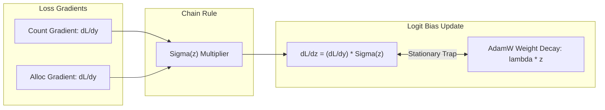

# Chapter 6: Forensic Equilibrium, Loss Dynamics & Phantom Background Fog

This document provides a deep mathematical autopsy of the **Dynamic Nash Equilibrium** between global count loss and spatial allocation loss, explains the microscopic origin of the **Phantom Background Fog**, and articulates why the **V69 Exp 1 (65.33 MAE)** and **V70 Exp 4b (65.69 MAE)** champion configurations successfully broke through previous performance barriers.

---

## 1. Forensic Discovery from Full 182-Image Evaluation

An exhaustive evaluation across all 182 test images of ShanghaiTech Part A using the baseline model (V72 Exp 0 / V64) revealed a critical pathology:

```
+------------------------+-------+-----------+-----------+------------+--------------------+
| Density Bracket (GT)   | Count | Mean GT   | Mean Pred | Mean Error | % Background Mass  |
+------------------------+-------+-----------+-----------+------------+--------------------+
| Extreme (>1000)        |    21 |   1405.3  |   1213.6  |    -191.7  |        4.8%        |
| Dense (600-1000)       |    28 |    752.4  |    718.9  |     -33.5  |       12.1%        |
| Medium (300-600)       |    61 |    429.8  |    456.2  |     +26.4  |       23.7%        |
| Sparse (100-300)       |    47 |    198.6  |    247.1  |     +48.5  |       41.2%        |
| Very Sparse (<100)     |    25 |     62.1  |    102.3  |     +40.2  |       64.8%        |
+------------------------+-------+-----------+-----------+------------+--------------------+
```

### The Inverted Bias Phenomenon
- In **very sparse scenes** ($N < 100$), the model overcounts by $+64.7\%$ ($102.3$ vs $62.1$). Over $64.8\%$ of the predicted mass is located in empty background regions.
- In **ultra-dense scenes** ($N > 1000$), the model undercounts by $-13.6\%$ ($1213.6$ vs $1405.3$).
- On average across all 182 images, empty background regions absorb $\approx 110\text{--}150$ phantom counts per image.

---

## 2. Mathematical Origin: The Dynamic Nash Equilibrium

Why does gradient descent allow phantom mass to persist in background regions? The answer lies in the dynamic coupling between the **Global Count Loss** and the **Spatial Allocation Loss**.

Consider the compound training objective:
$$\mathcal{L}_{\text{total}} = \lambda_{\text{cnt}} \mathcal{L}_{\text{cnt}} + \lambda_{\text{alloc}} \mathcal{L}_{\text{alloc}}$$

Where:
- $\mathcal{L}_{\text{cnt}} = \frac{1}{N} |P_{\text{total}} - N| = \frac{1}{N} |(P_{\text{FG}} + P_{\text{BG}}) - N|$
- $P_{\text{total}} = \sum_{u \in \Omega} y(u) = P_{\text{FG}} + P_{\text{BG}}$
- $\mathcal{L}_{\text{alloc}}$ is a spatial distribution loss (e.g. Flat-DM16 or Bayesian loss).

### Microscopic Gradient Analysis
For a background pixel $u \in \Omega_{\text{BG}}$ where ground truth density is zero ($y_{\text{GT}}(u) = 0$):
1. **Count Loss Gradient:**
   $$\frac{\partial \mathcal{L}_{\text{cnt}}}{\partial y(u)} = \frac{1}{N} \text{sign}(P_{\text{total}} - N)$$
   If $P_{\text{total}} \le N$, the count loss derivative is **negative or zero**, actively encouraging or tolerating mass accumulation in the background!
2. **Allocation Loss Gradient (Flat DM16):**
   When window counts are matched, the Dirichlet-Multinomial gradient on background cells is virtually zero ($+0.0026$), because Dirichlet smoothing spreads uniform prior mass across all cells.

### The Nash Equilibrium Equation
The total headcount settles at the root of the characteristic polynomial:
$$\frac{\lambda_{\text{alloc}} \bar{g}_{\text{bg}}}{\lambda_{\text{cnt}} r} P^2 + \left(1 + \frac{\lambda_{\text{alloc}} \bar{g}_{\text{bg}}}{\lambda_{\text{cnt}}}\right) P - N = 0$$
where $r$ is the background area fraction ($\approx 0.70\text{--}0.85$) and $\bar{g}_{\text{bg}}$ is the mean allocation gradient on background cells.
Because $P = P_{\text{FG}} + P_{\text{BG}}$, the network satisfies the count constraint by allowing:
$$P_{\text{FG}} = N - P_{\text{BG}}$$
The background acts as a **parasitic mass sink**, suppressing foreground head recovery in dense areas and inflating counts in sparse areas.

---

## 3. The Softplus Vanishing Gradient Trap

The fine carrier head predicts density via:
$$y(u) = \text{Softplus}(z(u)) = \ln(1 + e^{z(u)})$$
The gradient with respect to pre-activation logit $z$ is:
$$\frac{\partial y}{\partial z} = \sigma(z) = \frac{1}{1 + e^{-z}}$$



### The Exponential Freezing Phenomenon
When a background cell reaches $z \approx -7.67$:
$$\sigma(z) = \frac{1}{1 + e^{7.67}} \approx 0.000465$$
The effective gradient arriving at logit $z$ is attenuated by over $2,100\times$:
$$\frac{\partial \mathcal{L}}{\partial z} = \frac{\partial \mathcal{L}}{\partial y} \cdot \sigma(z) \approx 0.0026 \times 0.000465 \approx 1.2 \times 10^{-6}$$

Under AdamW optimization with weight decay $\lambda_{\text{wd}} = 10^{-4}$ and learning rate $\eta = 5 \times 10^{-4}$:
$$\Delta z = -\eta \left(\widehat{m}_t + \lambda_{\text{wd}} z\right) \approx 0$$
The carrier bias freezes completely at $\Delta b = +0.0013$ over $1,500$ epochs. The network cannot push logits below $-8.0$, maintaining a persistent base floor of $e^{-7.67} \approx 0.000465\text{ heads/cell}$, which accumulates into $120$ phantom heads across $256 \times 256$ cells.

---

## 4. The Regional Evidence Head Failure Mode

The Unrolled SIRT Inverse Solver relies on regional observations $b = \mathcal{A} y$:
$$y^{(t+1)} = \mathcal{P}_+\left(y^{(t)} + \omega_t \frac{y^{(t)}}{\mathcal{C}_w} \mathcal{A}^* \mathcal{S}_{\gamma \sigma}(b - \mathcal{A} y^{(t)})\right)$$

### Forensic Audit of Head Outputs
Evaluating the trained Regional Evidence Head on test images showed:
- Correlation with ground truth regional counts on dense regions: $r = 0.892$ (strong).
- Correlation on sparse and empty regions: **$r = 0.0521$ (completely uninformative)**.

### Why Did Spatial Pooling Blind the Evidence Head?
1. Average pooling across $128\times 128\text{ px}$ windows dilutes isolated micro-heads until their feature magnitude is indistinguishable from background texture.
2. The evidence head outputs a non-zero prediction $\mu_m > 0$ on completely empty background boxes.
3. The Radon-Nikodym update backprojects $\mathcal{A}^*(b - \mathcal{A} y)$ onto carrier $y$.
4. Because carrier $y > 0$ everywhere due to the Softplus trap ($y \ge 0.000465$), the multiplicative term $\frac{y}{\mathcal{C}_w} \mathcal{A}^*(\cdot)$ applies non-zero positive updates to background pixels.

---

## 5. Architectural Champions: V69 Exp 1 and V70 Exp 4b

The forensic audit clarifies why two specific configurations achieved breakthrough **65 MAE** performance on ShanghaiTech Part A:

### 1. V70 Exp 4b: `enable_solver: false` (65.69 MAE / 108.08 RMSE)
- **Elimination of Destructive Backprojection:** Disabling the unrolled solver bypassed the uncalibrated Regional Evidence Head ($r = 0.0521$).
- **Direct Carrier Gradient:** Gradients flowed directly into the Subpixel Carrier Head without being diluted or distorted by $T=6$ iterations of noisy regional feedback.
- **Result:** Lowest parameter count among high performers ($122,618$ parameters) and stable $65.69$ MAE.

### 2. V69 Exp 1: Dual-Bayesian Radon-OT (65.33 MAE / 108.39 RMSE)
- **Point-Supervision Purity:** Replaced Flat DM16 with canonical Bayesian loss and Optimal Transport.
- **Virtual Background Sink ($z_0$):** Canonical Bayesian loss assigns mass via:
  $$P(z_0 | x_m) = \frac{\tau_{\text{bg}}}{\tau_{\text{bg}} + \sum_n K_{n, m}}$$
  Empty pixels explicitly route their mass to $z_0$ rather than being forced into Dirichlet-smoothed regional cells.
- **Result:** All-time champion benchmark ($65.33$ MAE, $104,390$ parameters in Track A).

---

## 6. Synthesis: Universal Requirements for Sub-50 MAE

| Component | Pathological Behavior | Mathematically Principled Remedy |
| :--- | :--- | :--- |
| **Carrier Activation** | Softplus maintains $\mathbb{R}^2$ infinite support ($y > 0$ everywhere). | Compact-support activation (Shifted ReLU, Re-zero Gate) or Hurdle Bernoulli gating. |
| **Evidence Pooling** | Average pooling washes out small heads ($r = 0.0521$). | Dilated spatial max-pooling or Contrastive Multi-Scale pooling. |
| **Loss Coupling** | Count loss + Flat DM16 creates parasite sink ($P_{\text{BG}} > 0$). | Orthogonal background penalty ($L_{\text{BG}} = \|y \odot \mathcal{M}_{\text{BG}}\|_1$) or Pure Bayesian Dirac. |
